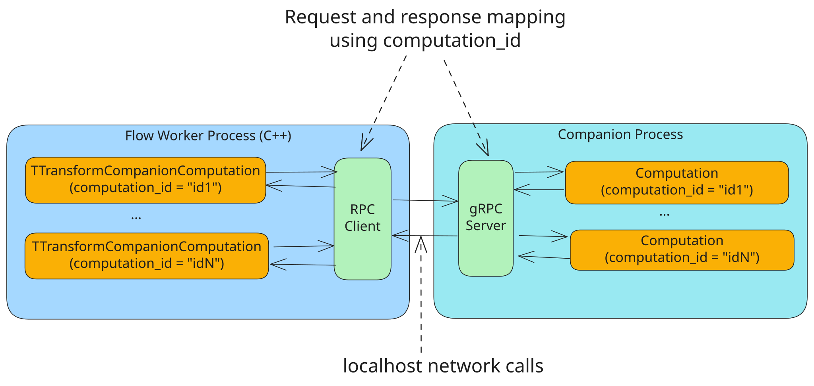

# Companion in {{product-name}} Flow

In Flow, you can run user code in a separate process. This process is called a companion process.

## Companion use cases
### Currently used

- Supporting computations in languages other than [C++](../../../flow/cpp/getting-started.md), such as [Python](../../../flow/python/getting-started.md), [Java and Kotlin](../../../flow/java/getting-started.md), and [Go](../../../flow/go/getting-started.md).
- Running user C++ code in a separate process through the [C++ companion](#cpp-companion).

### Planned

- Hot updating user code without stopping the [pipeline](../../../flow/concepts/glossary.md#pipeline).

## Workflow {#schema}

When you use a companion, the [Computation](../../../flow/concepts/glossary.md#stream-and-computation) consists of two parts: a specialized Computation on the [Worker](../../../flow/concepts/glossary.md#worker) side and a lightweight Computation on the companion side.



You develop all business logic in the chosen programming language on the companion side, while the pipeline structure is still configured via the [spec](../../../flow/concepts/spec.md). In this workflow, the worker becomes an infrastructure binary that doesn’t depend on the pipeline logic. So, when you use Python, Go, Java, or Kotlin, you don’t need to write any C++ user code.



The Computation on the Worker side collects a batch of messages, enriches it with all the information needed for processing (states, parameters, watermark values, and so on), and sends it to the companion via gRPC locally, within a single host.

The batch is formed without regard to [keys](../../../flow/concepts/glossary.md#key) — one request may contain messages with different keys; this is how the worker collects batches for all computations. There is no per-key grouping in the companion protocol: if the business logic needs per-key processing, it is done in the companion code — see the [Python](../../../flow/python/computation.md#batch-function) example.

The companion returns its output in groups; each group carries [lineage](../../../flow/concepts/lineage.md) — the list of ids of the input messages of the batch its output was derived from (lineage is unrelated to keys). For when lineage must be set explicitly and what exactly to pass, see [When to set lineage explicitly](../../../flow/concepts/lineage.md#explicit-lineage).

In the future, you’ll also be able to use Unix sockets.



You manage the companion process through the [resource](../../../flow/concepts/glossary.md#resource) `CompanionManager`.

### Configuration

Here’s an example of declaring the resource in a static spec for Java:

```yson
"CompanionManager" = {
    "resource_class_name" = "NYT::NFlow::NCompanion::TJavaCompanionManager";
    "parameters" = {
        "timeout" = "10s";
        "jdk_bin_path" = "/app/ytflow/jdk/bin/java";
        "main_class" = "tech.ytsaurus.flow.examples.wordcount.WordCountApplication";
        "classpath" = "/app/ytflow/lib/*";
    };
    "dependencies" = {};
};
```

For a detailed description of all `TCompanionManagerParameters` parameters, see the section [CompanionManager resource configuration](../../../flow/java/computation.md#companion-manager).

The Python companion configuration is described in the section [CompanionManager resource configuration (Python)](../../../flow/python/computation.md#companion-manager).

Here’s an example of declaring a Computation in a static spec:

```yson
"computations" = {
    "mapper" = {
        "computation_class_name" = "NYT::NFlow::NCompanion::TTransformCompanionComputation";
        "group_by_schema" = [
            {"name" = "hash"; "expression" = "farm_hash(word)"; "type" = "uint64"; required = %true;};
            {"name" = "word"; "type" = "string";};
        ];
        "input_stream_ids" = ["words"];
        "output_stream_ids" = [];
        "required_resource_ids" = {
            "CompanionManager" = {
                "controller" = false;
                "worker" = true;
            };
        };
        "parameters" = {
            "internal_states" = ["word-state"];
        };
    };
};
```

The key point in this example is using the `CompanionManager` resource to launch the companion process and the specialized Computation class `NYT::NFlow::NCompanion::TTransformCompanionComputation`.

### C++ companion {#cpp-companion}

You can move user C++ code out of the worker into a separate process as well. The SDK is located in `yt/yt/flow/library/cpp/companion/server`: you declare the served Computations in `TPipeline`, specifying the process function type (this typed declaration replaces `YT_FLOW_DEFINE_PROCESS_FUNCTION`), and build a separate binary with the `RunCompanionMain` entry point:

```cpp
int main(int argc, const char** argv)
{
    NYT::NFlow::NCompanionServer::TPipeline pipeline;
    pipeline.AddSource<TMyReadFunction, TMyReadParameters>("reader");
    pipeline.AddTransform<TMyMapFunction>("mapper");
    return NYT::NFlow::NCompanionServer::RunCompanionMain(argc, argv, std::move(pipeline));
}
```

The function is selected by the name from the `processing_function` field of the Computation spec, the same way as in the in-process `TProcessFunctionComputation` adapters. The worker launches the binary through the generic `TCompanionManager` resource:

```yson
"CompanionManager" = {
    "resource_class_name" = "NYT::NFlow::NCompanion::TCompanionManager";
    "parameters" = {
        "entrypoint" = {
            "executable" = "/path/to/my_companion";
        };
    };
};
```

A process function in a companion can take the HTTP clients from `IRuntimeInitContext` in `Init` (`GetHttpClient()`, `GetHttpsClient()`). The clients are configured by the `http_client_config`, `https_client_config` and `http_poller_threads` fields of the `companion` block of the worker node config ([TCompanionConfig](../../../flow/generated_docs/all_yson_structs.md#NYT_NFlow_NCompanion_TCompanionConfig)).

Limitations of the first version of the C++ companion:

- sync process functions aren’t supported (the companion protocol has no Sync phase);
- distributed throttlers and the epoch timestamp (`GetCurrentTimestamp`) aren’t available;
- `GetStreamSpecs()->ComputeKey()` can’t compute a key when `group_by_schema` has computed columns: a companion doesn’t evaluate expressions. The key arrives with the message — use `message->Key`;
- external states are supported only as `TSimpleExternalState`;
- output timers can only reference the key of one of the parent entities of the batch;
- the companion runs as a single multithreaded process.

For an example, see `yt/yt/flow/examples/cpp/companion_word_count`.

For registration, build dependencies and worker wiring, see [Running C++ process functions in a companion](../../../flow/cpp/companion.md). [Companion-hosted resources](#companion-resources) are available through `GetStaticResource`; resources that exist only in the worker are not transferred automatically.

### Companion resource wiring {#companion-resources}

A companion-hosted resource is an object created inside the companion and shared by the jobs served by that process. The worker holds a proxy and sends lifecycle commands to it. Resource APIs are documented for [Python](../../../flow/python/resources.md), [Java and Kotlin](../../../flow/java/resources.md), and [C++](../../../flow/cpp/companion.md#resources-and-http).

Three names serve different purposes:

#|
|| **Name** | **Where it is used** ||
|| Implementation name | `parameters.companion_resource_class` selects a factory registered in the companion. ||
|| Resource id | A key in `spec.resources` identifies one resource in the pipeline. Several ids can use one implementation. ||
|| Alias | A dependency or computation requirement can expose the resource under `alias`. Without an alias, lookup uses the resource id. ||
|#

After registering the implementation in your language SDK, connect it in the spec:

1. Configure the companion manager according to the language's getting-started guide.
1. Add the resource to `spec.resources` with `resource_class_name = "NYT::NFlow::NCompanion::TCompanionResource"`. Set `parameters.companion_resource_class` to the registered implementation name, and put your static parameters in the same `parameters` map.
1. In the resource's `dependencies`, require the manager on the worker under alias `CompanionManager`. Set `worker = %true` and `controller = %false`. If its resource id is already `CompanionManager`, no explicit alias is needed.
1. Declare any other companion-hosted dependencies in that map, also with worker-only requirements. Their aliases are local to the resource's dependency context. Flow initializes dependencies before dependents.
1. In the computation's `required_resource_ids`, require both the manager and the hosted resource on the worker (`worker = %true`, `controller = %false`). The manager must be exposed as `CompanionManager`; the hosted resource's alias is the name used by user code.
1. Put dynamic resource parameters in `dynamic_spec.resources.<resource_id>.parameters`. Flow delivers updates to the resource lifecycle; changing static configuration follows the [pipeline configuration rules](../../../flow/devops/vanilla/releases.md#release-and-configure-basic-rules).

See the maintained [Python]({{source-root}}/yt/yt/flow/tests/companion/resource/python/pipeline.yson), [JVM]({{source-root}}/yt/yt/flow/tests/companion/resource/java/companion/src/main/resources/pipeline.yson) and [C++]({{source-root}}/yt/yt/flow/tests/companion/resource/cpp/pipeline.yson) specs. They distinguish the resource id `greeting`, computation alias `greeting_view`, and dependency-local alias `dependency`.

#### Initialization and recovery {#companion-resource-failures}

The worker proxy's `parameters.init_backoff` controls retries during initial loading. An unregistered resource class, an unsupported resource command or a stale resource incarnation fails that loading attempt without the transient-error retry loop. For an unknown class, compare `companion_resource_class` with the registration in the actual companion executable.

`parameters.keep_alive_interval` controls periodic idempotent initialization. It must be positive. Repeated initialization of an unchanged live instance does not call its factory or `load` again. Periodic initialization can retry a failed reconfiguration and rebuild resources after a companion process restart. If a dependency instance changes, a dependent resource can be recreated with the updated binding.

Batches carry exact resource-instance and configuration references. A missing or stale reference prevents that batch from entering user code; the worker can initialize the graph and retry. This mechanism does not synchronize the mutable state of a resource already held by a batch. Follow the language-specific lifecycle and concurrency rules.

### Types of Computations for working with companions {#computation-types}

- `NYT::NFlow::NCompanion::TSwiftMapCompanionComputation`: An implementation of [TSwiftMapComputation](../../../flow/concepts/computation.md#tswiftmapcomputation) that delegates data processing to the companion process.
- `NYT::NFlow::NCompanion::TSwiftOrderedSourceCompanionComputation`: An implementation of [TSwiftOrderedSourceComputation](../../../flow/concepts/computation.md#tswiftorderedsourcecomputation) that delegates data processing to the companion process.
- `NYT::NFlow::NCompanion::TTransformCompanionComputation`: An implementation of [TTransformComputation](../../../flow/concepts/computation.md#ttransformcomputation) that delegates data processing to the companion process.
- `NYT::NFlow::NCompanion::TTransformOrderedSourceCompanionComputation`: An implementation of [TTransformOrderedSourceComputation](../../../flow/concepts/computation.md#ttransformorderedsourcecomputation) that delegates data processing to the companion process.

Two modes are available for a Source computation. `TSwiftOrderedSourceCompanionComputation` doesn’t materialize the output and requires deterministic processing without user state. `TTransformOrderedSourceCompanionComputation` materializes the output and commits it together with the internal state and the source offset in the epoch transaction. Choose it for non-deterministic processing or for working with internal state; the key of such a state is the source partition key. The spec limitations are the same as for [TTransformOrderedSourceComputation](../../../flow/concepts/computation.md#ttransformorderedsourcecomputation).

For more details on implementing pipelines using companions, see [Java and Kotlin](../../../flow/java/getting-started.md), [Python](../../../flow/python/getting-started.md), and [Go](../../../flow/go/getting-started.md).

## See also

- [Computation](../../../flow/concepts/computation.md)
- [Quick start (Java)](../../../flow/java/getting-started.md)
- [Quick start (Python)](../../../flow/python/getting-started.md)
- [Quick start (Go)](../../../flow/go/getting-started.md)
