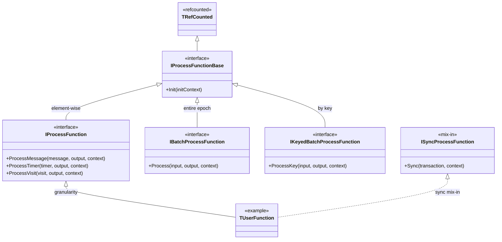

# Process function in {{product-name}} Flow (C++)

## Why you need it

Implement new C++ user logic only as a process function. Direct inheritance from `TTransformComputation`, `TSwiftMapComputation`, `TSwiftOrderedSourceComputation`, or `TTransformOrderedSourceComputation` is a low-level API for framework and legacy maintenance, not an authoring model for new user computations. Such logic is tightly coupled with the `Computation` object, inherits dozens of protected methods, and can only be constructed from a fully built `TComputationContext`, so it’s nearly impossible to test in isolation with unit tests.

A process function moves your custom logic into a separate, lightweight object. This object receives its dependencies (`IOutputCollector`, `IRuntimeContext`) as narrow interfaces and doesn’t depend on the `Computation` object itself. This lets you test the function in isolation with unit tests.

## How it works {#how-it-works}

The process function isn’t run directly. Instead, a built-in `Computation` adapter executes it. You specify this adapter in the spec via the `computation_class_name` field (see [Registration](#registration)). The adapter gives the function the same environment as a regular `Computation`: the same spec, the same stores and states, and the same epoch-processing logic. That’s why a pipeline with a process function provides the same [processing guarantees](../../../flow/concepts/guarantees.md) (including exactly-once) as a manually written `Computation`.

The adapter also defines the function’s execution mode. There are four built-in adapters:

| `computation_class_name` | Mode |
| --- | --- |
| `NYT::NFlow::TProcessFunctionComputation` | transform |
| `NYT::NFlow::TProcessFunctionSwiftMapComputation` | swift-map |
| `NYT::NFlow::TProcessFunctionSourceComputation` | source |
| `NYT::NFlow::TProcessFunctionTransformOrderedSourceComputation` | [ordered source with output materialization and state](../../../flow/cpp/computation.md#ttransformorderedsourcecomputation) |

You can run the same function under different adapters without rebuilding the binary.

## Interfaces

The library is `library/cpp/common` (`common/process_function.h`). The function selects **one** processing granularity by inheriting the corresponding interface. The spec determines which `Computation` (source, swift map, or transform) the function attaches to (see [Registration](#registration)). The base `IProcessFunctionBase` only includes `Init(initContext)` — initialization at the start of an [epoch](../../../flow/concepts/glossary.md#epoch). By default, this is a no-op. The granularity interfaces add the actual processing methods.

Choose the interface based on how you want to process the epoch’s input: one entity at a time, the entire batch at once, or by key. Then override only the methods you need. The worker will call them with the state and exactly-once semantics of the selected mode.

The function inherits one granularity interface and, if needed, the `ISyncProcessFunction` mix-in:



- `IProcessFunction` — element-wise processing (the most common case). The worker calls a method for each entity in the epoch. Override the methods you need; all are no-op by default:
    - `ProcessMessage(message, output, context)` — handles a single message.
    - `ProcessTimer(timer, output, context)` — handles a single [timer](../../../flow/concepts/glossary.md#timer).
    - `ProcessVisit(visit, output, context)` — handles a single visit.

    In source mode, only messages arrive, so `ProcessTimer` and `ProcessVisit` aren’t called.
- `IBatchProcessFunction` — processes the entire epoch input in a single call. Override `Process(input, output, context)` when your logic works with the whole batch at once (for example, a single batched external request). The input isn’t grouped by key. To combine batch work with per-entity handling — say, [one state preload](../../../flow/cpp/state.md#external-state-preload) for the whole batch — call the dispatch helpers `ProcessMessages` / `ProcessTimers` / `ProcessVisits(input, output, context, callback)` from `Process`: each sets the parents and tags errors with the key exactly as the worker does around `IProcessFunction` hooks, and takes a `TCallback` — `BIND(&TMyFunction::ProcessMessage, MakeStrong(this))` or a `BIND` of a lambda.
- `IKeyedBatchProcessFunction` — processes by key using group-by, for keyed modes (swift map and transform). The worker groups the epoch’s input by key and calls `ProcessKey` for each key:
    - `ProcessKey(input, output, context)` — handles all input for a single key (messages, timers, and visits together). It’s no-op by default. Override it when your logic relies on the entire key batch at once (for example, to reconcile messages and timers via the key’s shared state).
- `ISyncProcessFunction` — an optional mix-in for functions that commit side effects in a separate sync phase at the end of the epoch. You inherit it in addition to the granularity interface:
    - `Sync(transaction, context)` — commits side effects in the `transaction`. The `context` gives access to runtime accessors. You must implement this method. It’s called only by a `Computation` adapter that has a sync phase — among the built-in adapters, that’s `TProcessFunctionComputation` (transform) and `TProcessFunctionTransformOrderedSourceComputation` (ordered source). The spec validation checks this match: you can’t attach a function with `Sync` to a `Computation` without a sync phase.

In `Process` (`IBatchProcessFunction`) and `ProcessKey`, the `output` doesn’t have parent messages set — you must set them yourself via `output->SetParents(...)`. In the element-wise methods of `IProcessFunction` (`ProcessMessage`, `ProcessTimer`, `ProcessVisit`), they’re already set for the corresponding entity.

The `Distribute` field in `TAddMessageOptions` mirrors the `OutputCollector` semantics in `Computation`: for source, a message with `Distribute = false` isn’t published but is still considered when evaluating the [watermark](../../../flow/concepts/glossary.md#timestamps-and-watermarks); for other `Computation` types, such a message is simply discarded.

### Message ID suffixes in Swift {#message-id-suffixes}

In Swift mode, you can select the derived message ID suffix in `TAddMessageOptions`:

```cpp
output->AddMessage(std::move(message));
output->AddMessage(
    std::move(hashedMessage),
    TAddMessageOptions{
        .MessageIdSuffix = TOutputMessageIdSuffix::FromPayloadHash(),
    });
output->AddMessage(
    std::move(keyedMessage),
    TAddMessageOptions{
        .Distribute = false,
        .MessageIdSuffix = TOutputMessageIdSuffix::FromUserDefined(semanticKey),
    });
```

- With default options, or with `FromSequenceNumber()`, Flow uses the current message sequence number for the parent message ID and output stream pair.
- `FromPayloadHash()` uses a 128-bit CityHash of the canonical payload wire representation. Equal payloads with the same parent and stream get the same message ID; a hash collision is theoretically possible.
- `FromUserDefined(...)` accepts a non-empty user-defined suffix. Flow encodes it as a separate lexicographic component, so it cannot impersonate a sequence-number suffix. The caller is responsible for keeping it stable and unique among distinct logical messages with the same parent and stream.

Payload hashes and user-defined suffixes are supported only by Swift computations. They let message identity be independent of emission order, but they don’t remove the [Swift determinism requirement](../../../flow/concepts/swift.md#determinism): the same message ID must still denote the same logical output.



A process function is `TRefCounted`, so you must always create it via `New<...>()`.



## IRuntimeContext

`context` (of type `IRuntimeContext`, `common/runtime_context.h`) is an interface that collects everything a `Computation` usually reads from `this`:

| Method | Description |
| --- | --- |
| `GetWatermark(streamId)` / `GetInputEventWatermark()` | Event-time [watermarks](../../../flow/concepts/glossary.md#timestamps-and-watermarks) |
| `GetSpec()` / `GetStreamSpecs()` / `GetKeySchema()` | Spec and stream schemas |
| `MakeOutputMessageBuilder(streamId)` | Output message builder |
| `ConvertToOutputMessage(message, streamId)` | Converts a message to the output stream’s schema |
| `ConvertToMessage(ysonMessage)` | `TYsonMessage` → `TMessage` |
| `ConvertToYsonMessage<T>(message)` | `TMessage` → typed `TYsonMessage` |
| `MakeTimer(key, streamId, trigger, event)` | Creates a [timer](../../../flow/concepts/glossary.md#timer) |
| `GetThrottlerOrThrow(throttlerId)` | Gets a distributed throttler |
| `TryGetThrottler(throttlerId)` | Same, but returns `nullptr` if the throttler is not declared |

## States

Typed state clients (`TMutableStateKeyClient<T>` and others) are stored as function fields and initialized in `Init` via `IRuntimeInitContext` (`common/runtime_init_context.h`):

```cpp
void Init(const IRuntimeInitContextPtr& initContext) override
{
    initContext->InitExternalStateClient(StateClient_, "/state");
    // or: initContext->InitClient<TMyState>(Client_, "my-state");
}
```

For more details on state types, see the [Working with states](../../../flow/cpp/state.md) section.

## Parameters {#parameters}

A function can declare its own parameter structure — a regular `TYsonStruct` — and read it in a typed way. You pass parameters in the `processing_function_parameters` field at the top level of the `Computation` spec (next to `processing_function`):

- Static — `processing_function_parameters` in `spec`, read once in `Init` via `initContext->GetParameters<T>()`.
- Dynamic — `processing_function_parameters` in `dynamic_spec`, read via `context->GetDynamicParameters<T>()` and reflect the latest reconfiguration.

Both blocks are parsed into the parameter types declared when registering the function (see below), so `T` in `GetParameters<T>()` / `GetDynamicParameters<T>()` must be the registered type — a mismatch throws. If the `processing_function_parameters` field is missing, the structure is filled with default values. The static block is parsed once at job init; the dynamic one is reparsed only when it changes (that is, on reconfiguration).

You specify parameter types when registering the function via macro arguments: `YT_FLOW_DEFINE_PROCESS_FUNCTION(function, TStaticParams)` for the static block, `YT_FLOW_DEFINE_PROCESS_FUNCTION(function, TStaticParams, TDynamicParams)` also for the dynamic one. Then the corresponding `processing_function_parameters` block (in `spec` and `dynamic_spec`) is validated against the schema when loading the spec, just like `parameters` for `Computation`: an unknown field or incorrect type causes an error before the run. A block for which you didn’t declare a type (including for a parameterless `YT_FLOW_DEFINE_PROCESS_FUNCTION(function)`) is treated as empty — any passed field will be rejected.

```cpp
struct TMyParameters
    : public NYTree::TYsonStruct
{
    i64 Threshold;

    REGISTER_YSON_STRUCT(TMyParameters);

    static void Register(TRegistrar registrar)
    {
        registrar.Parameter("threshold", &TThis::Threshold).Default(0);
    }
};

void Init(const IRuntimeInitContextPtr& initContext) override
{
    Threshold_ = initContext->GetParameters<TMyParameters>()->Threshold;
}

void ProcessMessage(const TInputMessageConstPtr& message, const IOutputCollectorPtr& output, const IRuntimeContextPtr& context) override
{
    auto currentThreshold = context->GetDynamicParameters<TMyParameters>()->Threshold;
    // ...
}

// Registering with a parameter type enables validation in the spec.
YT_FLOW_DEFINE_PROCESS_FUNCTION(TMyFunction, TMyParameters);
```

In the spec:

```yson
"counter" = {
    "computation_class_name" = "NYT::NFlow::TProcessFunctionComputation";
    "processing_function" = "NYT::NFlow::NExample::TWordCountFunction";
    "processing_function_parameters" = {
        "threshold" = 5;
    };
};
```

In unit tests, set static parameters via `TTestStateEnvironment::SetStaticParameters(...)` — the passed struct is served to `GetParameters<T>()` as is. Dynamic ones go through the production path: name the function via `TTestRuntimeContextBuilder().SetProcessingFunction<TMyFunction>()` (it must be registered in the test binary) and pass the struct to `SetDynamicParameters(...)`; the context reparses it into the registered dynamic type.

## Composing functions {#function-graph}

When several process functions handle data in sequence or split a stream, you can run them in one `Computation` as a graph. Each node of the graph is a separately registered process function; messages between nodes stay inside the worker instead of passing through intermediate pipeline streams.

Describe the graph in the static spec, in the `process_function_graph` field of a computation with `computation_class_name = "NYT::NFlow::TProcessFunctionComputation"` (Transform) or `"NYT::NFlow::TProcessFunctionSwiftMapComputation"` (Swift map). A node has the same fields as a computation that hosts one process function: `processing_function`, `processing_function_parameters`, `input_stream_ids`, `output_stream_ids`, `timer_streams`, and `streams_dependency`. Nodes are connected by stream IDs, the same way computations are connected in a pipeline:

- The `input_stream_ids` and `output_stream_ids` of the computation are the boundary of the graph.
- A node reads the streams listed in its `input_stream_ids`: inputs of the computation or outputs of other nodes. Several nodes can read one stream, and one node can read several streams.
- Each stream is written by one node. A stream written by a node and not listed in the `output_stream_ids` of the computation is internal to the graph.

In the pipeline spec of the integration test, the `graph` computation counts messages of two input streams in separate nodes and merges the results in a third one:



Register every stream the nodes use, including internal ones, like any other pipeline stream. The same test does it in `PrepareSpec`:



No other C++ code is needed: the functions are registered with `YT_FLOW_DEFINE_PROCESS_FUNCTION` as usual, and a function sees the same stream IDs in a graph as in a computation of its own.

### Graph rules {#function-graph-rules}

The runner resolves the graph after `PrepareSpec` and stops with an error if the graph breaks any of these rules:

- Every node reads at least one stream. Each stream it reads is an input of the computation or an output of another node.
- Every stream a node writes is read by another node or listed in the `output_stream_ids` of the computation. To drop messages, read the stream with a node that has no `output_stream_ids`.
- Every input of the computation is read by a node, and every output is written by a node.
- The graph has no cycles. Node, timer, and internal stream IDs match `[0-9A-Za-z_-]+`.
- An internal stream is not used by other computations. To pass a stream to another computation, list it in `output_stream_ids`.
- Every stream read by a node contains the non-expression columns of `group_by_schema`. Columns with expressions are computed into the key from the payload, so they do not have to be present in the stream schema.
- The computation does not set `processing_function`, `processing_function_parameters`, `timer_streams`, `streams_dependency`, or `allow_timer_self_dependency`: they are generated from the graph.
- The computation keeps the default precise watermarks: `watermark_strategy.watermark_percentile.value` is 100.
- The computation does not set `watermark_strategy.event_timestamp_assigner`: a message written to an internal stream inherits the minimum event timestamp of its parents, so set event timestamps in the node that emits the messages.
- In Swift, message outputs do not depend on timer streams: timers cannot be parents of messages.

After resolution, the computation runs `NYT::NFlow::TGraphProcessFunction`: `processing_function_parameters` contains the graph and the specs of its streams, and `timer_streams` and `streams_dependency` are computed from the nodes. Internal streams are removed from the pipeline `streams`. Only the resolved spec reaches the controller and workers; it is validated again before the pipeline starts. The controller rejects a spec with `process_function_graph`, so set such a spec by starting the pipeline binary, not with `set_pipeline_spec`. Applications with their own runner call `ResolveProcessFunctionGraphs(spec)` from `common/process_function_graph.h` before validating the spec.

### Node parameters {#function-graph-parameters}

Each node has its own parameters, typed as described in [Parameters](#parameters):

- Static parameters are set in `processing_function_parameters` of the node. Unknown fields and invalid values are errors. Several nodes can run one function with different parameters and separate state.
- Dynamic parameters are set in `dynamic_spec.computations.<computation_id>.processing_function_parameters.nodes.<node_id>`, for example `nodes = {left = {multiplier = 2;};}`. Unknown nodes and invalid values are rejected before the dynamic spec is saved. Updates take effect at epoch boundaries within each partition.

### Keys, state, and timers {#function-graph-state}

- All nodes share the `group_by_schema` and partitioning of the computation. A message written to an internal stream must have the key of its parents: a key change requires a separate computation. A batch function whose input contains several keys must set the parents of each output with `output->SetParents(...)`.
- The state of each node uses the `functions/<node_id>/` prefix, so nodes can reuse state names. Renaming a node starts it with empty state. Do not rename or remove a node or its timer while the timer has pending instances: the jobs of the computation fail to start until the timer stream is restored. This is the same rule as for removing a timer stream of a computation.
- A timer is declared in the `timer_streams` of its node and returns only to that node. The `streams` or `streams_with_delays` of a timer name input streams of the node; without them, the timer watches all inputs of the node. A timer sets at most one of these fields.
- By default, an output of a node depends on all inputs and timers of the node, and a timer depends on all inputs of the node and on itself. Unlike a computation with one function, a timer can reschedule itself without `allow_timer_self_dependency`, but it cannot schedule another timer of the node unless `streams_dependency` allows it. `streams_dependency` of the node narrows or changes these sets; include every actual dependency, including effects through state. A message or timer without an allowed parent fails the epoch.
- When a timer handler schedules a timer again, set the event timestamp of the new timer explicitly. Otherwise the new timer inherits the event timestamp of the fired one and holds back the event watermark of every output and timer that depends on it.
- A node sees the watermarks of all pipeline streams. For an internal stream or a local timer ID, the event watermark is the minimum over the computation inputs and timers it derives from, and `GetInputEventWatermark()` covers the inputs of the node. A timer emits messages with the current system timestamp, so the system watermark of an internal stream covers only the computation inputs it derives from. As a result, an `event_time` timer that watches an internal stream waits for the pending timers of the upstream nodes, while a `system_time` timer does not.
- Nodes share the computation and partition IDs. Transform nodes also share the epoch commit and sequence number. Swift does not publish an epoch sequence number, so `GetEpochUniqueSeqNo()` is unavailable in its nodes. A function that derives external identifiers from shared context values must add a node-specific part, such as `IRuntimeInitContext::GetPrefix()`.

### Execution {#function-graph-execution}

Nodes run once per epoch in topological order; independent nodes run in the order of their IDs. A node that reads several streams receives the input messages of the computation first and then the outputs of other nodes in that order. As between computations, do not rely on the relative order of messages from different streams. Messages between nodes stay in memory until the end of the epoch and have no separate limit: if nodes multiply messages, reduce the input batch of the computation with `max_rows_per_batch` and `max_bytes_per_batch`.

Source connectors, key visitors, companions, external state managers, joined state clients, nested graphs, and functions implementing `ISyncProcessFunction` are not supported inside a graph; keep them in separate computations. Node state and timers are persisted by the hosting computation without a user `Sync` hook.

### Message IDs and retries {#function-graph-message-ids}

A graph hosted by `TProcessFunctionComputation` (Transform) shares the computation's commit. In the default `exactly_once` processing mode, input confirmations, node state, timers, and materialized outputs are committed atomically. If a job fails before commit, its replacement restores committed state and processes the input again. A node can therefore run more than once for the same logical input.

Messages received from the computation's inputs retain their IDs. Both hosts derive internal IDs deterministically from the original parents at the computation boundary, the output stream, and the resolved suffix. The default suffix is a sequence number scoped to the boundary-parent set and stream. User-defined and payload-hash suffixes are additionally scoped to the immediate parents. A replay with the same parents and logical outputs reproduces internal IDs independently of the epoch sequence number. Changed parent sets or output count/order can change default IDs; Transform does not require the node logic itself to be deterministic.

Timestamps and exported IDs follow the host policy. Transform assigns the current epoch timestamp internally and fresh IDs to exported messages; persisted redelivery restores the saved external IDs. Swift inherits the maximum system timestamp and minimum alignment timestamp of the boundary parents and derives external IDs with the normal Swift metadata setter. In both modes, an unset event timestamp inherits the minimum event timestamp of the immediate parents. Scheduled timer IDs are assigned by the host.

Swift requires deterministic replay. A batch node receives the full batch; use `output->SetParents(...)` for each result that belongs to one input. The strict mode requires one original boundary message parent, so fan-in of descendants of that same input is allowed. Merging different boundary inputs requires `parameters/allow_batching_with_relaxed_guarantees = %true` and provides at-least-once delivery; changing batch boundaries can also change merged identities.

Combining computations into a graph removes the materialization boundary between their functions. Internal IDs are suitable for replay deduplication only while their parents and suffixes remain stable; nondeterministic Transform logic or changed batch parent sets can produce different IDs. When those conditions do not hold, keep a materialized stream before the function, use a stable application identifier, or send the effect through a sink with the required delivery guarantee. Direct external requests from a node do not join the computation's transaction automatically.

Use output collectors and parent messages or timers only during the processing invocation that supplied them. To continue processing in a later epoch, use managed state and timers instead of retaining a collector or a parent handle.

### Testing a graph {#function-graph-testing}

`TProcessFunctionGraphTestHarness` from `process_function/testing/process_function_graph_test_harness.h` runs graph processing and commits managed test state between epochs. It does not simulate job recovery or roll back a failed epoch; use integration tests with worker restarts to check those paths. It takes the computation spec in YSON, as in the pipeline spec, and resolves it the same way as the runner, so graph rule violations fail the test. Outputs pass the production checks of `streams_dependency`. `computation_class_name` and `group_by_schema` can be omitted: they default to `TProcessFunctionComputation` and the key schema passed to the harness, `DefaultTestKeySchema()` by default. A `group_by_schema` set in the spec must equal that key schema.

The unit test of the same graph:



`GetMessages()` returns messages written to computation outputs with the IDs of their input parents. `GetTimers()` returns scheduled timers with the node and local timer ID. `SetNodeDynamicParameters`, `SetWatermark` and `SetCurrentTimestamp` configure the following epochs; node dynamic parameters are validated like the controller validates them.

## Registration {#registration}

You link the function and `Computation` via the spec. Register the function with a single macro from `common/registry.h` (in the same `TRegistry` as computation / source / sink) under its `TypeName`; the optional second argument is the type of its parameters (see [Parameters](#parameters)):

```cpp
YT_FLOW_DEFINE_PROCESS_FUNCTION(TWordCountFunction);                   // no parameters
YT_FLOW_DEFINE_PROCESS_FUNCTION(TTextReadFunction, TTextReaderParameters);  // with parameters
```

In the `Computation` spec, the `computation_class_name` field points to the built-in `Computation` adapter (which also sets the mode — see the [list of adapters](#how-it-works)), and the adjacent `processing_function` field names the function:

```yson
"counter" = {
    "computation_class_name" = "NYT::NFlow::TProcessFunctionComputation";
    "processing_function" = "NYT::NFlow::NExample::TWordCountFunction";
};
```

## Testing

The `library/cpp/process_function/testing` library provides a ready-made set of utilities for unit tests with sensible defaults (all its utilities live in the separate `NYT::NFlow::NTesting` namespace to keep test code separate from production):

- `TRecordingOutputCollector` — an `IOutputCollector` that records messages and timers in vectors (`GetMessages()` / `GetTimers()`).
- `TTestRuntimeContextBuilder` — builds an `IRuntimeContext`; by default, it uses zero watermarks, one output stream for each registered `RegisterStream<T>(id)`, and the key schema `DefaultTestKeySchema()`.
- `TTestStateEnvironment` — starts a `TJobStateManager` over in-memory mock tables and provides an `IRuntimeInitContext`; `PreloadKeyStates(inputContext)` loads keys before processing, and `ReadKeyState<T>(name, key)` reads the state afterward.
- `entity_builders.h` — `MakeTestMessage`, `MakeTestRawMessage`, `MakeTestTimer`, `MakeTestVisit`.
- `TProcessFunctionGraphTestHarness` — runs a [process function graph](#function-graph-testing) across epochs.
- `TProcessFunctionTestHarness` — runs the function across epochs like a worker does: it wraps the function as batch (via `WrapAsBatch`, so per-element, whole-batch, and per-key forms all work the same way, and timers and visits are dispatched alongside messages), calls `Init` once, and for each `RunEpoch(...)` it preloads the state, processes the input, executes the end-of-epoch `Sync` for `ISyncProcessFunction`, and commits the state. You can access the last epoch’s messages and timers via `GetMessages()` / `GetTimers()`.

The umbrella header `process_function/testing/unittest.h` includes all the listed utilities; in a test, you only need to include it instead of the individual harness headers.

`TTestStateEnvironment` covers all state types the function uses:

- Internal (`InitClient`) — work directly via `TJobStateManager` over in-memory tables; the function writes them and reads them back via `ReadKeyState<T>(name, key)`.
- External managers (`InitExternalStateClient` with `TMutableStateKeyClient<T>`) — register via `RegisterExternalState(name, ...)`; there’s a ready-made in-memory `TInMemorySimpleExternalStateManager` for `TSimpleExternalState`, and you can read the result via `ReadExternalKeyState<T>(name, key)`.
- External joiners (`InitExternalStateClient` with `TJoinedStateKeyClient<T>`) — register via `RegisterExternalStateJoiner(name, ...)`; the in-memory `TInMemorySimpleExternalStateJoiner` is seeded via `GetMutableState(key)` before the function starts.
- Internal joiners of another computation’s state (`InitClient` with `TJoinedStateKeyClient<T>`) — register via `RegisterStateJoiner(name, stateName)`; in a single environment, you can run a producer function (it writes the state), call `Sync()`, and then run a joiner function that reads it.

`RegisterExternalState` / `RegisterExternalStateJoiner` also accept an arbitrary `IExternalStateManagerPtr` / `IExternalStateJoinerPtr` — this way, you connect a real manager built over a {{product-name}} mock client in the test. For BigRT profiles, there are ready-made wrappers; see [Serializable Profile](#profile-testing).

Example of a test for a row function with state:

```cpp
TTestStateEnvironment stateEnv;
auto context = TTestRuntimeContextBuilder().Build();
auto output = New<TRecordingOutputCollector>();

auto function = New<TCountingRowFunction>();
function->Init(stateEnv.GetInitContext());

auto key = MakeKey<ui64>(7);
auto message = MakeTestMessage("input", key, New<NTableClient::TTableSchema>());
stateEnv.PreloadKeyStates(New<TInputContext>(
    std::vector<TInputMessageConstPtr>{message},
    std::vector<TInputTimerConstPtr>{}));

function->ProcessMessage(message, output, context);

EXPECT_EQ(stateEnv.ReadKeyState<i64>("counter", key), 1);
```

The same test using `TProcessFunctionTestHarness`, which hides `Init`, preload, context/output setup, and epoch commit (full example — [queue_reduce/unittest]({{source-root}}/yt/yt/flow/yandex/extensions/bigrt/examples/queue_reduce/unittest/queue_reduce_functions_ut.cpp)):

```cpp
TTestStateEnvironment stateEnv;
TProcessFunctionTestHarness harness(stateEnv, New<TCountingRowFunction>());

auto key = MakeKey<ui64>(7);
harness.RunEpoch({MakeTestMessage("input", key, New<NTableClient::TTableSchema>())});

EXPECT_EQ(stateEnv.ReadKeyState<i64>("counter", key), 1);
```



### Serializable Profile {#profile-testing}

If a function’s external state is stored in [Serializable Profile](../../../flow/cpp/state.md#profile-manager) format (`TProfileManager<TProfile>` / `TProfileJoiner<TProfile>`), the `yandex/extensions/bigrt/cpp/serializable_profile/testing` library (namespace `NYT::NFlow::NBigRTExtensions::NTesting`) starts a real manager or joiner over an in-memory {{product-name}} mock client. The mock table schema is derived automatically from `TProfile::RemoteTableSchema()`; you don’t need to write it manually.

- `TTestProfileManager<TProfile>` — a wrapper around `TProfileManager<TProfile>`. `Create(env, {.KeySchema = ...})` registers the manager in `TTestStateEnvironment` (call this before the function’s `Init`). Then, for the epoch lifecycle: `PreloadKeyStates({key})` loads keys (reading a non-preloaded key throws an exception), `GetState(key)` returns a mutable accessor for seeding or checking, `Commit()` flushes changes to the mock table, and `ReadKeyState(key)` re-reads the state via a fresh manager.
- `TTestProfileJoiner<TProfile>` — a read-only analog over `TProfileJoiner<TProfile>`: `Seed(key, fill)` populates the reference profile, and `PreloadKeyStates({key})` is called before the function reads it.

The profile type must be registered in the test binary — the manager and joiner resolve their parameters via the registry:

```cpp
YT_FLOW_DEFINE_EXTERNAL_STATE_MANAGER(NYT::NFlow::NBigRTExtensions::TProfileManager<TMyProfile>);
```

For `TTestProfileJoiner::Seed`, which writes via the internal manager, you need both the joiner and manager registrations.

Example of a test for a function with Serializable Profile state — a full, compilable test for `TProfileCountingFunction` (increment `SimpleColumn` of the `TTestProfile` profile for each message). `TProcessFunctionTestHarness` handles the preload and epoch commit; the test only needs to `Create` the manager and use `ReadKeyState` for verification:



Another full test example — [queue_reduce/unittest]({{source-root}}/yt/yt/flow/yandex/extensions/bigrt/examples/queue_reduce/unittest/queue_reduce_functions_ut.cpp).



For more details on the general approach to testing C++ computations, see the [Testing](../../../flow/cpp/testing.md) section.

## Example

Full example — [examples/cpp/word_count]({{source-root}}/yt/yt/flow/examples/cpp/word_count) (both classes are `IProcessFunction` in the `NYT::NFlow::NExample` namespace, registered via `YT_FLOW_DEFINE_PROCESS_FUNCTION`). In `pipeline.yson`, `TTextReadFunction` is connected to `TProcessFunctionSourceComputation`, and `TWordCountFunction` is connected to `TProcessFunctionComputation` via `processing_function`; `TTextReadFunction` reads its static `min_word_length` parameter from `processing_function_parameters`. A more complex example with timers and window-based joining is [examples/cpp/wait_click_join]({{source-root}}/yt/yt/flow/examples/cpp/wait_click_join).

## See also

- [Computation (C++)](../../../flow/cpp/computation.md)
- [Working with states (C++)](../../../flow/cpp/state.md)
- [Testing (C++)](../../../flow/cpp/testing.md)
- [Quick start (C++)](../../../flow/cpp/getting-started.md)
