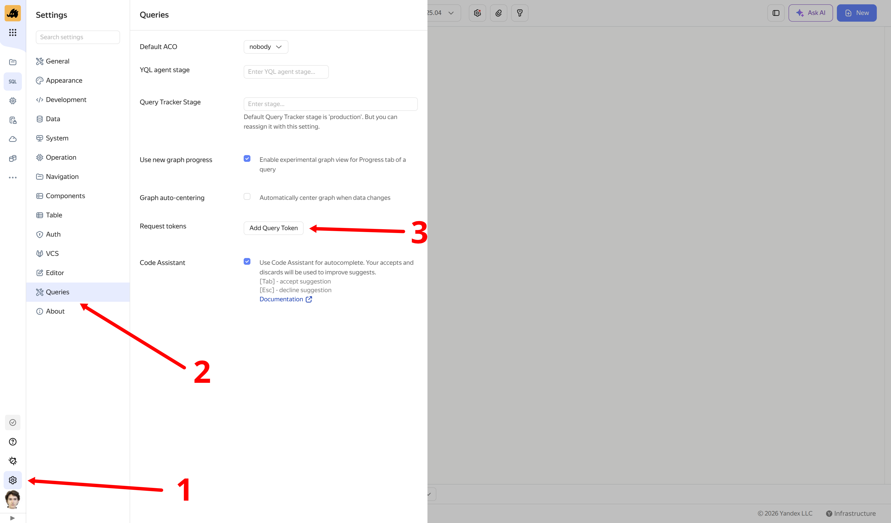
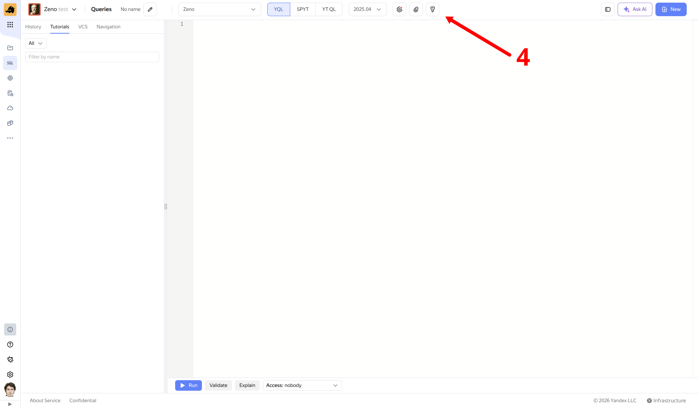

# Authentication in YQL over {{product-name}} Flow

To authenticate with {{product-name}} as someone other than your query's submitting user, or with external providers (Monium, Logbroker), add token through {{product-name}} UI.

## Uploading a token to Cypress {#upload-token}

Before adding a token in UI settings, upload file containing it to Cypress. Example command:

```bash
cat /path/to/local/secret | {{yt-cli}} --proxy <pipeline-cluster> write-file //path/to/secret
```



You are responsible for securing your token file using ACLs.<br>
Only you should have access to this file — make sure no one else has permission to read this node.



## Adding a token {#add-token}

To add a token:

1. Open **Settings** using its gear icon at bottom left.
2. Select **Queries** in your settings sidebar.
3. Under **Request tokens**, click **Add Query Token** and specify Cypress path to your token file.
4. Attach tokens to your query: open **Tokens** using its key icon in your top toolbar and select tokens to attach.

## Token names {#token-names}

To use a token by default without specifying additional pragmas, choose its name by provider:

- `default_ytflow` — for access to internal {{product-name}} Flow tables.
- `default_yt` — for access to {{product-name}}.

- `default_solomon` — for access to Monium.
- `default_pq` — for access to Logbroker.


To select a custom token for a query, use its provider's `{provider}.Auth` pragma.










