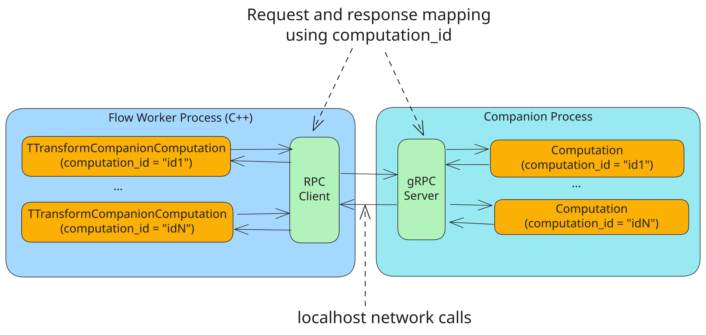

# Companion в {{product-name}} Flow

Во Flow имеется возможность запуска пользовательского кода в отдельном процессе. Такой процесс называется процессом-компаньоном.

## Области применения компаньонов
### Используется сейчас

- Поддержка вычислений на языках, отличных от [C++](../../../flow/cpp/getting-started.md), таких как [Python](../../../flow/python/getting-started.md) и [Java и Kotlin](../../../flow/java/getting-started.md), а также [Go](../../../flow/go/getting-started.md).
- Запуск пользовательского C++ кода в отдельном процессе через [C++-компаньон](#cpp-companion).

### Планы

- Горячее обновление пользовательского кода без остановки [пайплайна](../../../flow/concepts/glossary.md#pipeline).

## Схема работы {#schema}

При использовании компаньона [Computation](../../../flow/concepts/glossary.md#stream-and-computation) состоит из двух частей: специализированного Computation-a на стороне [Worker](../../../flow/concepts/glossary.md#worker)-a и облегчённого Computation-a на стороне компаньона.



Вся бизнес-логика разрабатывается на выбранном языке программирования на стороне компаньона, а форма пайплайна по-прежнему конфигурируется через [спеку](../../../flow/concepts/spec.md). В этой схеме работы воркер становится инфраструктурным бинарником, который не зависит от логики пайплайна, то есть при использовании Python, Go, Java или Kotlin пользовательский код на C++ писать **не нужно**.



Computation на стороне Worker-a собирает батч сообщений, обогащает его всей необходимой для обработки информацией (стейты, параметры, значения watermarks и т.п.) и отправляет его компаньону по gRPC локально в рамках одного хоста.

Батч формируется без учёта [ключей](../../../flow/concepts/glossary.md#key) — один запрос может содержать сообщения с разными ключами; так воркер собирает батчи для любых компьютейшенов. Группировки по ключам в протоколе компаньона нет: если бизнес-логике нужна обработка по ключам, она выполняется в коде компаньона — см. пример для [Python](../../../flow/python/computation.md#batch-function).

Вывод компаньон возвращает группами; каждая группа несёт [lineage](../../../flow/concepts/lineage.md) — список id входных сообщений батча, из которых получен её вывод (с ключами lineage не связан). Когда lineage необходимо задавать явно и что именно указывать — см. [Когда задавать lineage явно](../../../flow/concepts/lineage.md#explicit-lineage).

В дальнейшем планируется использовать и unix sockets.



Управление процессом-компаньоном осуществляется через [ресурс](../../../flow/concepts/glossary.md#resource) `CompanionManager`.

### Конфигурация

Пример объявления ресурса в статической спеке для Java:

```yson
"CompanionManager" = {
    "resource_class_name" = "NYT::NFlow::NCompanion::TJavaCompanionManager";
    "parameters" = {
        "main_class" = "tech.ytsaurus.flow.examples.wordcount.WordCountApplication";
        "timeout" = "10s";
        "jdk_bin_path" = "/app/ytflow/jdk/bin/java";
        "classpath" = "/app/ytflow/lib/*";
    };
    "dependencies" = {};
};
```

Подробное описание всех параметров `TCompanionManagerParameters` см. в разделе [Конфигурация ресурса CompanionManager](../../../flow/java/computation.md#companion-manager).

Конфигурация Python-компаньона описана в разделе [Конфигурация ресурса CompanionManager (Python)](../../../flow/python/computation.md#companion-manager).

Пример объявления Computation в статической спеке:
```yson
"computations" = {
    "mapper" = {
        "computation_class_name" = "NYT::NFlow::NCompanion::TTransformCompanionComputation";
        "group_by_schema" = [
            {"name" = "hash"; "expression" = "farm_hash(word)"; "type" = "uint64"; required = %true;};
            {"name" = "word"; "type" = "string";};
        ];
        "input_stream_ids" = ["words"];
        "output_stream_ids" = [];
        "required_resource_ids" = {
            "CompanionManager" = {
                "controller" = false;
                "worker" = true;
            };
        };
        "parameters" = {
            "internal_states" = ["word-state"];
        };
    };
};
```

Ключевое в данном примере – использование ресурса `CompanionManager` для запуска процесса-компаньона и специализированный класс Computation-a `NYT::NFlow::NCompanion::TTransformCompanionComputation`.

### C++ компаньон {#cpp-companion}

Пользовательский C++ код тоже можно вынести из воркера в отдельный процесс. SDK находится в `yt/yt/flow/library/cpp/companion/server`: пользователь объявляет обслуживаемые Computation-ы в `TPipeline`, указывая тип process function (типизированное объявление заменяет `YT_FLOW_DEFINE_PROCESS_FUNCTION`), и собирает отдельный бинарник с точкой входа `RunCompanionMain`:

```cpp
int main(int argc, const char** argv)
{
    NYT::NFlow::NCompanionServer::TPipeline pipeline;
    pipeline.AddSource<TMyReadFunction, TMyReadParameters>("reader");
    pipeline.AddTransform<TMyMapFunction>("mapper");
    return NYT::NFlow::NCompanionServer::RunCompanionMain(argc, argv, std::move(pipeline));
}
```

Функция выбирается по имени из поля `processing_function` спеки Computation-а — так же, как во внутрипроцессных адаптерах `TProcessFunctionComputation`. Воркер запускает бинарник через универсальный ресурс `TCompanionManager`:

```yson
"CompanionManager" = {
    "resource_class_name" = "NYT::NFlow::NCompanion::TCompanionManager";
    "parameters" = {
        "entrypoint" = {
            "executable" = "/path/to/my_companion";
        };
    };
};
```

Process function в компаньоне может брать в `Init` HTTP-клиенты из `IRuntimeInitContext` (`GetHttpClient()`, `GetHttpsClient()`). Клиенты настраиваются полями `http_client_config`, `https_client_config` и `http_poller_threads` блока `companion` конфига воркера ([TCompanionConfig](../../../flow/generated_docs/all_yson_structs.md#NYT_NFlow_NCompanion_TCompanionConfig)).

Ограничения первой версии C++ компаньона:

- не поддерживаются sync process function-ы (у протокола компаньона нет фазы Sync);
- недоступны распределённые троттлеры и timestamp эпохи (`GetCurrentTimestamp`);
- `GetStreamSpecs()->ComputeKey()` не вычисляет ключ, если в `group_by_schema` есть вычисляемые колонки: компаньон не вычисляет выражения. Ключ приходит вместе с сообщением — используйте `message->Key`;
- внешние стейты поддерживаются только в виде `TSimpleExternalState`;
- таймеры на выходе могут указывать только ключ одной из родительских сущностей батча;
- компаньон работает одним многопоточным процессом.

Пример: `yt/yt/flow/examples/cpp/companion_word_count`.

Регистрация, сборочные зависимости и подключение к воркеру описаны в статье [Запуск C++ process-функций в companion](../../../flow/cpp/companion.md). [Ресурсы, размещённые в companion](#companion-resources), доступны через `GetStaticResource`; ресурсы, существующие только в воркере, не переносятся автоматически.

### Подключение ресурсов companion {#companion-resources}

Ресурс companion — объект, который создаётся внутри companion и доступен джобам этого процесса. Воркер хранит прокси ресурса и передаёт команды жизненного цикла. API ресурсов описаны для [Python](../../../flow/python/resources.md), [Java и Kotlin](../../../flow/java/resources.md) и [C++](../../../flow/cpp/companion.md#resources-and-http).

Три имени выполняют разные задачи:

#|
|| **Имя** | **Где используется** ||
|| Имя реализации | `parameters.companion_resource_class` выбирает фабрику, зарегистрированную в companion. ||
|| Идентификатор ресурса | Ключ в `spec.resources` обозначает один ресурс пайплайна. Разные идентификаторы могут использовать одну реализацию. ||
|| Псевдоним | Зависимость или требование компьютейшена может предоставлять ресурс под именем `alias`. Если псевдоним не задан, поиск использует идентификатор ресурса. ||
|#

Зарегистрируйте реализацию в SDK выбранного языка и подключите её в спецификации:

1. Настройте менеджер companion по руководству по началу работы для выбранного языка.
1. Добавьте ресурс в `spec.resources` с `resource_class_name = "NYT::NFlow::NCompanion::TCompanionResource"`. В `parameters.companion_resource_class` укажите зарегистрированное имя реализации; в тот же словарь `parameters` добавьте свои статические параметры.
1. В `dependencies` ресурса добавьте требование менеджера на воркере под псевдонимом `CompanionManager`. Задайте `worker = %true` и `controller = %false`. Если сам идентификатор ресурса — `CompanionManager`, явный псевдоним не нужен.
1. В том же словаре объявите остальные зависимости, размещённые в companion, также только для воркера. Их псевдонимы действуют в контексте зависимостей этого ресурса. Flow инициализирует зависимости раньше зависимых ресурсов.
1. В `required_resource_ids` компьютейшена добавьте менеджер и размещённый ресурс с `worker = %true`, `controller = %false`. Менеджер должен быть доступен под именем `CompanionManager`; псевдоним размещённого ресурса используется в пользовательском коде.
1. Динамические параметры ресурса задайте в `dynamic_spec.resources.<resource_id>.parameters`. Flow передаёт обновления методам жизненного цикла. При изменении статической конфигурации соблюдайте [правила настройки пайплайна](../../../flow/devops/vanilla/releases.md#release-and-configure-basic-rules).

См. поддерживаемые спецификации [Python]({{source-root}}/yt/yt/flow/tests/companion/resource/python/pipeline.yson), [JVM]({{source-root}}/yt/yt/flow/tests/companion/resource/java/companion/src/main/resources/pipeline.yson) и [C++]({{source-root}}/yt/yt/flow/tests/companion/resource/cpp/pipeline.yson). В них различаются идентификатор ресурса `greeting`, псевдоним компьютейшена `greeting_view` и локальный псевдоним зависимости `dependency`.

#### Инициализация и восстановление {#companion-resource-failures}

Параметр прокси `parameters.init_backoff` управляет повторами при начальной загрузке. Незарегистрированный класс ресурса, неподдерживаемая команда ресурса или устаревший экземпляр завершают эту попытку загрузки без цикла повторов для временных ошибок. Если класс не найден, сравните `companion_resource_class` с регистрацией в фактически запускаемом исполняемом файле companion.

Параметр `parameters.keep_alive_interval` задаёт период идемпотентной инициализации и должен быть положительным. Повторная инициализация неизменившегося работающего экземпляра не вызывает фабрику или `load` заново. Периодическая инициализация позволяет повторить неудачную переконфигурацию и восстановить ресурсы после перезапуска процесса companion. При изменении экземпляра зависимости зависимый ресурс может быть создан заново с обновлённой привязкой.

Батчи передают точные ссылки на экземпляры и конфигурации ресурсов. Если ссылка отсутствует или устарела, батч не попадает в пользовательский код; воркер может инициализировать граф и повторить обработку. Этот механизм не синхронизирует изменяемые данные ресурса, уже полученного батчем. Соблюдайте правила жизненного цикла и конкурентного доступа для выбранного языка.

### Виды Computation-ов для работы с компаньонами

- `NYT::NFlow::NCompanion::TSwiftMapCompanionComputation`: Реализация [TSwiftMapComputation](../../../flow/concepts/computation.md#tswiftmapcomputation) делегирующая обработку данных процессу-компаньону.
- `NYT::NFlow::NCompanion::TSwiftOrderedSourceCompanionComputation`: Реализация [TSwiftOrderedSourceComputation](../../../flow/concepts/computation.md#tswiftorderedsourcecomputation) делегирующая обработку данных процессу-компаньону.
- `NYT::NFlow::NCompanion::TTransformCompanionComputation`: Реализация [TTransformComputation](../../../flow/concepts/computation.md#ttransformcomputation) делегирующая обработку данных процессу-компаньону.
- `NYT::NFlow::NCompanion::TTransformOrderedSourceCompanionComputation`: Реализация [TTransformOrderedSourceComputation](../../../flow/concepts/computation.md#ttransformorderedsourcecomputation) делегирующая обработку данных процессу-компаньону.

Для Source-компьютейшена доступны два режима. `TSwiftOrderedSourceCompanionComputation` не материализует выход и требует детерминированной обработки без пользовательского стейта. `TTransformOrderedSourceCompanionComputation` материализует выход и фиксирует его вместе с внутренним стейтом и смещением источника в транзакции эпохи. Его следует выбирать для недетерминированной обработки или работы с внутренним стейтом; ключом такого стейта служит ключ партиции источника. Ограничения спеки совпадают с [TTransformOrderedSourceComputation](../../../flow/concepts/computation.md#ttransformorderedsourcecomputation).

Подробнее о реализации пайплайнов с использованием компаньонов: [Java и Kotlin](../../../flow/java/getting-started.md), [Python](../../../flow/python/getting-started.md), [Go](../../../flow/go/getting-started.md).

## См. также

- [Computation](../../../flow/concepts/computation.md)
- [Быстрый старт (Java)](../../../flow/java/getting-started.md)
- [Быстрый старт (Python)](../../../flow/python/getting-started.md)
- [Быстрый старт (Go)](../../../flow/go/getting-started.md)
