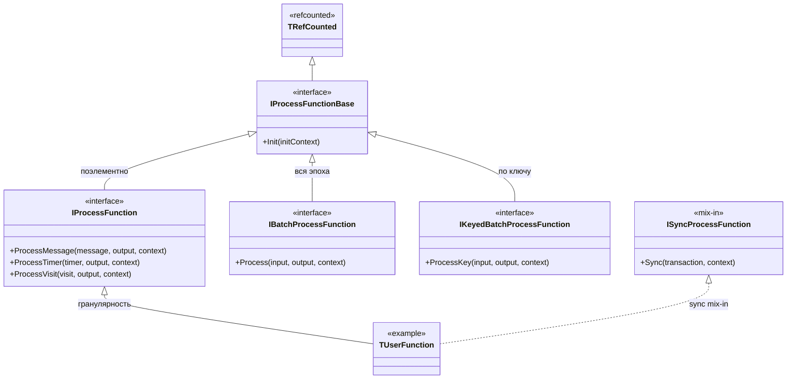

# Process function в {{product-name}} Flow (C++)

## Зачем это нужно

Новую пользовательскую логику на C++ реализуйте только как process function. Прямое наследование от `TTransformComputation`, `TSwiftMapComputation`, `TSwiftOrderedSourceComputation` или `TTransformOrderedSourceComputation` — low-level API для фреймворка и сопровождения legacy-кода, а не способ создания новых пользовательских компьютейшенов. Такая логика «вплетена» в объект `Computation`, наследует десятки protected-методов и конструируется только из полностью собранного `TComputationContext`, поэтому её практически невозможно покрыть юнит-тестами в изоляции.

Process function выносит пользовательскую логику в отдельный лёгкий объект, который получает свои зависимости (`IOutputCollector`, `IRuntimeContext`) как узкие интерфейсы и не имеет зависимости на сам объект `Computation`. Благодаря этому такую функцию можно протестировать изолированно при помощи юнит-тестов.

## Как это работает {#how-it-works}

Сама process function напрямую не запускается — её исполняет встроенный `Computation`-адаптер, который указывается в спеке в поле `computation_class_name` (см. [Регистрация](#registration)). Адаптер даёт функции ровно ту же среду, что и обычный `Computation`: ту же спеку, те же сторы и стейты, ту же логику обработки эпохи. Поэтому пайплайн с process function даёт [те же гарантии обработки](../../../flow/concepts/guarantees.md) (в том числе exactly-once), что и написанный вручную `Computation`.

Адаптер же задаёт режим исполнения функции. Встроенных адаптеров четыре:

| `computation_class_name` | Режим |
| --- | --- |
| `NYT::NFlow::TProcessFunctionComputation` | transform |
| `NYT::NFlow::TProcessFunctionSwiftMapComputation` | swift-map |
| `NYT::NFlow::TProcessFunctionSourceComputation` | source |
| `NYT::NFlow::TProcessFunctionTransformOrderedSourceComputation` | [ordered source с материализацией выхода и стейтом](../../../flow/cpp/computation.md#ttransformorderedsourcecomputation) |

Одну и ту же функцию можно запускать под разными адаптерами, не пересобирая бинарь.

## Интерфейсы

Библиотека `library/cpp/common` (`common/process_function.h`). Функция выбирает **одну** гранулярность обработки, наследуясь от соответствующего интерфейса; на какой `Computation` (source, swift map или transform) её повесить, задаёт спека (см. [Регистрация](#registration)). Базовый `IProcessFunctionBase` несёт только `Init(initContext)` — инициализацию в начале [эпохи](../../../flow/concepts/glossary.md#epoch), по умолчанию no-op; сами методы обработки добавляют интерфейсы гранулярности. Выбирайте интерфейс по тому, как удобно обрабатывать вход эпохи — по одной сущности, всем батчем сразу или по ключу — и переопределяйте только нужные методы; воркер сам вызовет их со стейтами и семантикой exactly-once выбранного режима.

Функция наследует один интерфейс гранулярности и, при необходимости, mix-in `ISyncProcessFunction`:



- `IProcessFunction` — поэлементная обработка (самый частый случай). Воркер вызывает метод на каждую сущность эпохи; переопределяйте нужные, все по умолчанию no-op:
    - `ProcessMessage(message, output, context)` — одно сообщение;
    - `ProcessTimer(timer, output, context)` — один [таймер](../../../flow/concepts/glossary.md#timer);
    - `ProcessVisit(visit, output, context)` — один визит.

    В обоих source-режимах приходят только сообщения, поэтому `ProcessTimer` / `ProcessVisit` не вызываются.
- `IBatchProcessFunction` — весь вход эпохи одним вызовом. Переопределяйте `Process(input, output, context)`, когда логика работает со всем батчем сразу (например, один батчевый внешний запрос). Вход не группируется по ключу. Чтобы совместить батчевую работу с поэлементной обработкой — скажем, [одну предзагрузку стейта](../../../flow/cpp/state.md#external-state-preload) на весь батч — вызывайте из `Process` dispatch-хелперы `ProcessMessages` / `ProcessTimers` / `ProcessVisits(input, output, context, callback)`: каждый проставляет родителей и тегирует ошибку ключом ровно так, как воркер вокруг методов `IProcessFunction`, и принимает `TCallback` — `BIND(&TMyFunction::ProcessMessage, MakeStrong(this))` или `BIND` от лямбды.
- `IKeyedBatchProcessFunction` — обработка по ключу group-by, для keyed-режимов (swift map и transform). Воркер группирует вход эпохи по ключу и вызывает `ProcessKey` для каждого ключа:
    - `ProcessKey(input, output, context)` — весь вход одного ключа (сообщения, таймеры и визиты вместе), по умолчанию no-op. Переопределяйте, когда логика опирается на весь батч ключа сразу (например, согласует сообщения и таймеры через общий стейт ключа).
- `ISyncProcessFunction` — необязательный mix-in для функций, которые в конце эпохи фиксируют побочные эффекты в отдельной sync-фазе; от него наследуются дополнительно к интерфейсу гранулярности:
    - `Sync(transaction, context)` — фиксация побочных эффектов в транзакции `transaction`; `context` даёт доступ к рантайм-аксессорам. Метод обязателен к реализации. Вызывается только `Computation`-адаптером, у которого есть sync-фаза — из встроенных адаптеров это `TProcessFunctionComputation` (transform) и `TProcessFunctionTransformOrderedSourceComputation` (ordered source). Соответствие проверяется при валидации спеки: функцию с `Sync` нельзя повесить на `Computation` без sync-фазы.

В `Process` (`IBatchProcessFunction`) и `ProcessKey` у `output` не проставлены родительские сообщения — проставляйте их сами через `output->SetParents(...)`; в поэлементных методах `IProcessFunction` (`ProcessMessage` / `ProcessTimer` / `ProcessVisit`) они уже проставлены на соответствующую сущность.

Поле `Distribute` в `TAddMessageOptions` повторяет семантику `OutputCollector` у `Computation`: для source сообщение с `Distribute = false` не публикуется, но всё равно учитывается при оценке [вотермарка](../../../flow/concepts/glossary.md#timestamps-and-watermarks); для остальных `Computation` такое сообщение просто отбрасывается.

### Суффикс message id в Swift {#message-id-suffixes}

В Swift-режиме суффикс производного message id можно выбрать через `TAddMessageOptions`:

```cpp
output->AddMessage(std::move(message));
output->AddMessage(
    std::move(hashedMessage),
    TAddMessageOptions{
        .MessageIdSuffix = TOutputMessageIdSuffix::FromPayloadHash(),
    });
output->AddMessage(
    std::move(keyedMessage),
    TAddMessageOptions{
        .Distribute = false,
        .MessageIdSuffix = TOutputMessageIdSuffix::FromUserDefined(semanticKey),
    });
```

- С options по умолчанию или с `FromSequenceNumber()` используется текущий порядковый номер сообщения для пары «родительский message id, выходной стрим».
- `FromPayloadHash()` использует 128-битный CityHash от канонического wire-представления payload. Одинаковые payload одного родителя и стрима получают одинаковый message id; теоретическая коллизия хеша возможна.
- `FromUserDefined(...)` принимает непустой пользовательский суффикс. Flow кодирует его отдельным лексикографическим компонентом, поэтому он не может выдать себя за суффикс порядкового номера. Пользователь отвечает за его стабильность и уникальность среди разных логических сообщений одного родителя и стрима.

Хеш и пользовательский суффикс поддерживаются только Swift-компьютейшенами. Они позволяют не связывать идентичность сообщения с порядком эмита, но не отменяют [требование детерминированности Swift](../../../flow/concepts/swift.md#determinism): одинаковый message id всё равно должен обозначать один и тот же логический вывод.



Process function — `TRefCounted`, поэтому создавать её всегда нужно через `New<...>()`.



## IRuntimeContext

`context` (типа `IRuntimeContext`, `common/runtime_context.h`) — это интерфейс, который собирает всё, что `Computation` обычно читает из `this`:

| Метод | Описание |
| --- | --- |
| `GetWatermark(streamId)` / `GetInputEventWatermark()` | Event-time [вотермарки](../../../flow/concepts/glossary.md#timestamps-and-watermarks) |
| `GetSpec()` / `GetStreamSpecs()` / `GetKeySchema()` | Спека и схемы потоков |
| `MakeOutputMessageBuilder(streamId)` | Построитель выходного сообщения |
| `ConvertToOutputMessage(message, streamId)` | Привести сообщение к схеме выходного потока |
| `ConvertToMessage(ysonMessage)` | `TYsonMessage` → `TMessage` |
| `ConvertToYsonMessage<T>(message)` | `TMessage` → типизированный `TYsonMessage` |
| `MakeTimer(key, streamId, trigger, event)` | Создать [таймер](../../../flow/concepts/glossary.md#timer) |
| `GetThrottlerOrThrow(throttlerId)` | Получить distributed throttler |
| `TryGetThrottler(throttlerId)` | То же, но `nullptr`, если троттлер не объявлен |

## Стейты

Типизированные клиенты стейта (`TMutableStateKeyClient<T>` и др.) хранятся как поля функции и инициализируются в `Init` через `IRuntimeInitContext` (`common/runtime_init_context.h`):

```cpp
void Init(const IRuntimeInitContextPtr& initContext) override
{
    initContext->InitExternalStateClient(StateClient_, "/state");
    // или: initContext->InitClient<TMyState>(Client_, "my-state");
}
```

Подробнее о видах стейтов — в разделе [Работа со стейтами](../../../flow/cpp/state.md).

## Параметры {#parameters}

Функция может объявить собственную структуру параметров — обычный `TYsonStruct` — и прочитать её типизированно. Параметры передаются в поле `processing_function_parameters` верхнего уровня спеки `Computation` (рядом с `processing_function`):

- статические — `processing_function_parameters` в `spec`, читаются один раз в `Init` через `initContext->GetParameters<T>()`;
- динамические — `processing_function_parameters` в `dynamic_spec`, читаются через `context->GetDynamicParameters<T>()` и отражают последнюю реконфигурацию.

Оба блока разбираются в типы параметров, объявленные при регистрации функции (см. ниже), поэтому `T` в `GetParameters<T>()` / `GetDynamicParameters<T>()` должен совпадать с зарегистрированным типом — при несовпадении бросается исключение. Если поле `processing_function_parameters` отсутствует, структура заполняется значениями по умолчанию. Статический блок разбирается один раз при инициализации джоба, динамический — заново только при его изменении (то есть при реконфигурации).

Типы параметров указываются при регистрации функции аргументами макроса: `YT_FLOW_DEFINE_PROCESS_FUNCTION(function, TStaticParams)` — для статического блока, `YT_FLOW_DEFINE_PROCESS_FUNCTION(function, TStaticParams, TDynamicParams)` — ещё и для динамического. Тогда соответствующий блок `processing_function_parameters` (в `spec` и `dynamic_spec`) валидируется по схеме при загрузке спеки, как и `parameters` у `Computation`: неизвестное поле или неверный тип — ошибка ещё до запуска. Блок, для которого тип не объявлен (в т. ч. у беспараметрической `YT_FLOW_DEFINE_PROCESS_FUNCTION(function)`), считается пустым — любое переданное поле будет отвергнуто.

```cpp
struct TMyParameters
    : public NYTree::TYsonStruct
{
    i64 Threshold;

    REGISTER_YSON_STRUCT(TMyParameters);

    static void Register(TRegistrar registrar)
    {
        registrar.Parameter("threshold", &TThis::Threshold).Default(0);
    }
};

void Init(const IRuntimeInitContextPtr& initContext) override
{
    Threshold_ = initContext->GetParameters<TMyParameters>()->Threshold;
}

void ProcessMessage(const TInputMessageConstPtr& message, const IOutputCollectorPtr& output, const IRuntimeContextPtr& context) override
{
    auto currentThreshold = context->GetDynamicParameters<TMyParameters>()->Threshold;
    // ...
}

// Регистрация с типом параметров — включает их валидацию в спеке.
YT_FLOW_DEFINE_PROCESS_FUNCTION(TMyFunction, TMyParameters);
```

В спеке:

```yson
"counter" = {
    "computation_class_name" = "NYT::NFlow::TProcessFunctionComputation";
    "processing_function" = "NYT::NFlow::NExample::TWordCountFunction";
    "processing_function_parameters" = {
        "threshold" = 5;
    };
};
```

В юнит-тестах статические параметры задаются через `TTestStateEnvironment::SetStaticParameters(...)` — переданная структура отдаётся в `GetParameters<T>()` как есть. Динамические идут по продакшен-пути: функция называется через `TTestRuntimeContextBuilder().SetProcessingFunction<TMyFunction>()` (она должна быть зарегистрирована в тестовом бинаре), а структура передаётся в `SetDynamicParameters(...)`; контекст разбирает её заново в зарегистрированный динамический тип.

## Объединение функций {#function-graph}

Если несколько process function обрабатывают данные последовательно или разветвляют стрим, их можно запустить в одном `Computation` как граф. Каждый узел графа — отдельно зарегистрированная process function; сообщения между узлами передаются внутри воркера, а не через промежуточные стримы пайплайна.

Граф описывается в статической спеке, в поле `process_function_graph` компьютейшена с `computation_class_name = "NYT::NFlow::TProcessFunctionComputation"` (Transform) или `"NYT::NFlow::TProcessFunctionSwiftMapComputation"` (Swift map). У узла те же поля, что у компьютейшена с одной process function: `processing_function`, `processing_function_parameters`, `input_stream_ids`, `output_stream_ids`, `timer_streams` и `streams_dependency`. Узлы соединяются через идентификаторы стримов — так же, как компьютейшены в пайплайне:

- `input_stream_ids` и `output_stream_ids` компьютейшена задают границу графа.
- Узел читает стримы из своего `input_stream_ids`: входы компьютейшена или выходы других узлов. Один стрим могут читать несколько узлов, а один узел может читать несколько стримов.
- У каждого стрима один писатель — узел. Стрим, который пишет узел и которого нет в `output_stream_ids` компьютейшена, — внутренний стрим графа.

В спеке пайплайна интеграционного теста компьютейшен `graph` считает сообщения двух входных стримов в отдельных узлах и объединяет результаты в третьем:



Все стримы, которые используют узлы, включая внутренние, регистрируются как обычные стримы пайплайна. В том же тесте это делается в `PrepareSpec`:



Другого кода на C++ не нужно: функции регистрируются через `YT_FLOW_DEFINE_PROCESS_FUNCTION` как обычно, а в графе функция видит те же идентификаторы стримов, что и в отдельном компьютейшене.

### Правила графа {#function-graph-rules}

Раннер разбирает граф после `PrepareSpec` и завершается с ошибкой, если граф нарушает одно из правил:

- Каждый узел читает хотя бы один стрим. Каждый читаемый им стрим — вход компьютейшена или выход другого узла.
- Каждый стрим, который пишет узел, читает другой узел или он указан в `output_stream_ids` компьютейшена. Чтобы отбросить сообщения, читайте стрим узлом без `output_stream_ids`.
- Каждый вход компьютейшена читает какой-то узел, и каждый выход пишет какой-то узел.
- В графе нет циклов. Идентификаторы узлов, таймеров и внутренних стримов соответствуют `[0-9A-Za-z_-]+`.
- Внутренний стрим не используется другими компьютейшенами. Чтобы передать стрим в другой компьютейшен, укажите его в `output_stream_ids`.
- Каждый стрим, который читает узел, содержит колонки `group_by_schema` без выражений. Колонки с выражениями вычисляются в ключе по payload и не обязаны присутствовать в схеме стрима.
- В компьютейшене не заданы `processing_function`, `processing_function_parameters`, `timer_streams`, `streams_dependency` и `allow_timer_self_dependency`: они генерируются из графа.
- Компьютейшен использует точные вотермарки по умолчанию: `watermark_strategy.watermark_percentile.value` равно 100.
- В компьютейшене не задан `watermark_strategy.event_timestamp_assigner`: сообщение во внутреннем стриме наследует минимальный event timestamp своих родителей, поэтому задавайте event timestamp в узле, который пишет сообщения.
- В Swift выходные сообщения не зависят от стримов таймеров: таймеры не могут быть родителями сообщений.

После разбора компьютейшен выполняет `NYT::NFlow::TGraphProcessFunction`: в `processing_function_parameters` лежат граф и спеки его стримов, а `timer_streams` и `streams_dependency` вычисляются по узлам. Внутренние стримы удаляются из `streams` пайплайна. Контроллер и воркеры получают только разобранную спеку; перед запуском пайплайна она проверяется ещё раз. Контроллер отклоняет спеку с `process_function_graph`, поэтому такую спеку задают запуском бинарника пайплайна, а не через `set_pipeline_spec`. Приложения со своим раннером вызывают `ResolveProcessFunctionGraphs(spec)` из `common/process_function_graph.h` перед валидацией спеки.

### Параметры узлов {#function-graph-parameters}

У каждого узла свои параметры; их типы объявляются, как описано в разделе [Параметры](#parameters):

- Статические параметры задаются в `processing_function_parameters` узла. Неизвестные поля и неверные значения — ошибка. Несколько узлов могут выполнять одну функцию с разными параметрами и раздельными стейтами.
- Динамические параметры задаются в `dynamic_spec.computations.<computation_id>.processing_function_parameters.nodes.<node_id>`, например `nodes = {left = {multiplier = 2;};}`. Неизвестные узлы и неверные значения отклоняются до сохранения динамической спеки. Изменения применяются на границе эпохи в каждой партиции.

### Ключи, стейты и таймеры {#function-graph-state}

- Все узлы используют общие `group_by_schema` и партиционирование компьютейшена. Сообщение, которое узел пишет во внутренний стрим, должно иметь ключ своих родителей: для смены ключа нужен отдельный компьютейшен. Batch-функция, во входе которой несколько ключей, должна задавать родителей каждого выхода через `output->SetParents(...)`.
- Стейт каждого узла хранится с префиксом `functions/<node_id>/`, поэтому узлы могут использовать одинаковые имена стейтов. После переименования узел начинает с пустым стейтом. Не переименовывайте и не удаляйте узел или его таймер, пока у таймера есть отложенные срабатывания: джобы компьютейшена не запустятся, пока стрим таймера не вернут. Это то же правило, что и для удаления стрима таймера у компьютейшена.
- Таймер объявляется в `timer_streams` своего узла и возвращается только в этот узел. `streams` или `streams_with_delays` таймера перечисляют входные стримы узла; если они не заданы, таймер следит за всеми входами узла. Таймер задаёт не больше одного из этих полей.
- По умолчанию выход узла зависит от всех входов и таймеров узла, а таймер — от всех входов узла и от самого себя. В отличие от компьютейшена с одной функцией, таймер может перезапускать себя без `allow_timer_self_dependency`, но другой таймер узла он может запланировать, только если это разрешено в `streams_dependency`. `streams_dependency` узла сужает или меняет эти множества; указывайте все фактические зависимости, в том числе через стейт. Сообщение или таймер без разрешённого родителя приводит к ошибке эпохи.
- Если обработчик таймера снова планирует таймер, задайте event timestamp нового таймера явно. Иначе новый таймер наследует event timestamp сработавшего и задерживает event-вотермарку всех выходов и таймеров, которые от него зависят.
- Узел видит вотермарки всех стримов пайплайна. Для внутреннего стрима или локального идентификатора таймера event-вотермарка равна минимуму по входам и таймерам компьютейшена, от которых он зависит, а `GetInputEventWatermark()` учитывает входы узла. Таймер пишет сообщения с текущим system timestamp, поэтому system-вотермарка внутреннего стрима учитывает только входы компьютейшена, от которых он зависит. В результате таймер `event_time`, который следит за внутренним стримом, ждёт отложенных таймеров вышестоящих узлов, а таймер `system_time` — нет.
- У узлов общие идентификаторы компьютейшена и партиции. У Transform-узлов также общие коммит и порядковый номер эпохи. Swift не публикует порядковый номер эпохи, поэтому `GetEpochUniqueSeqNo()` в его узлах недоступен. Если функция строит внешние идентификаторы из общих значений контекста, добавьте к ним часть, уникальную для узла, например `IRuntimeInitContext::GetPrefix()`.

### Выполнение {#function-graph-execution}

Узлы выполняются один раз за эпоху в топологическом порядке; независимые узлы — в порядке их идентификаторов. Узел, который читает несколько стримов, получает сначала входные сообщения компьютейшена, а затем выходы других узлов в этом порядке. Как и между компьютейшенами, не полагайтесь на взаимный порядок сообщений разных стримов. Сообщения между узлами хранятся в памяти до конца эпохи, и отдельного лимита на них нет: если узлы размножают сообщения, уменьшите входной батч компьютейшена через `max_rows_per_batch` и `max_bytes_per_batch`.

Коннекторы источников, key visitors, компаньоны, менеджеры внешнего стейта, joined-клиенты стейта, вложенные графы и функции с `ISyncProcessFunction` внутри графа не поддерживаются; оставьте их в отдельных компьютейшенах. Стейт и таймеры узлов сохраняет компьютейшен без пользовательского хука `Sync`.

### Идентификаторы сообщений и повторы обработки {#function-graph-message-ids}

Граф на `TProcessFunctionComputation` (Transform) использует общий коммит компьютейшена. В режиме обработки `exactly_once`, выбранном по умолчанию, подтверждения входов, стейты узлов, таймеры и материализованные выходы фиксируются атомарно. Если джоба упала до коммита, новая джоба восстанавливает сохранённое состояние и обрабатывает вход повторно. Поэтому узел может выполниться несколько раз для одного логического входа.

Сообщения со входов компьютейшена сохраняют свои идентификаторы. Оба host детерминированно выводят внутренние ID из исходных родителей на границе компьютейшена, выходного стрима и значения suffix. По умолчанию suffix — порядковый номер в рамках множества исходных родителей и стрима. Пользовательский suffix и hash payload дополнительно привязаны к непосредственным родителям. Повтор обработки с теми же родителями и логическими выходами воспроизводит внутренние ID независимо от порядкового номера эпохи. Изменение множества родителей или количества и порядка выходов может изменить ID с suffix по умолчанию; Transform не требует детерминированности самой логики узлов.

Timestamps и внешние ID назначаются по правилам host. Transform использует текущий timestamp эпохи внутри графа и назначает свежие ID экспортируемым сообщениям; при повторной доставке сохранённых записей внешние ID восстанавливаются. Swift наследует максимальный system timestamp и минимальный alignment timestamp исходных родителей и выводит внешние ID через обычный Swift metadata setter. В обоих режимах незаданный event timestamp наследует минимальный event timestamp непосредственных родителей. ID запланированных таймеров назначает host.

Swift требует детерминированного replay. Batch-узел получает весь батч; используйте `output->SetParents(...)` для каждого результата, который относится к одному входу. Строгий режим требует одного исходного родительского сообщения на границе графа, поэтому fan-in потомков того же входа разрешён. Объединение разных исходных входов требует `parameters/allow_batching_with_relaxed_guarantees = %true` и даёт гарантию at-least-once; изменение границ батча может также изменить идентификаторы объединённых результатов.

Объединение компьютейшенов в граф убирает границу материализации между их функциями. Внутренние ID подходят для дедупликации повторов, только пока их родители и suffix остаются стабильными; недетерминированная логика Transform или изменение множества родителей батча могут породить другие ID. Если эти условия не выполняются, сохраните материализованный стрим перед функцией, используйте стабильный прикладной идентификатор или выполняйте эффект через sink с нужной гарантией доставки. Прямые внешние запросы узла автоматически не включаются в транзакцию компьютейшена.

Используйте output collector и родительские сообщения или таймеры только в том вызове обработки, который их предоставил. Для продолжения обработки в следующей эпохе используйте стейт и таймеры, а не сохранённый collector или ссылку на родителя.

### Тестирование графа {#function-graph-testing}

`TProcessFunctionGraphTestHarness` из `process_function/testing/process_function_graph_test_harness.h` выполняет обработку графа и сохраняет управляемое тестовое состояние между эпохами. Он не моделирует восстановление джобы и не откатывает неуспешную эпоху; проверяйте эти сценарии интеграционными тестами с перезапуском воркера. Он принимает спеку компьютейшена в YSON, как в спеке пайплайна, и разбирает её так же, как раннер, поэтому нарушение правил графа приводит к ошибке теста. Выходы проходят те же проверки `streams_dependency`, что и в продакшене. `computation_class_name` и `group_by_schema` можно не указывать: по умолчанию используются `TProcessFunctionComputation` и ключевая схема, переданная харнессу (по умолчанию `DefaultTestKeySchema()`). Если `group_by_schema` задана в спеке, она должна совпадать с этой ключевой схемой.

Юнит-тест того же графа:



`GetMessages()` возвращает сообщения, записанные в выходы компьютейшена, с идентификаторами их входных родителей. `GetTimers()` возвращает запланированные таймеры с узлом и локальным идентификатором таймера. `SetNodeDynamicParameters`, `SetWatermark` и `SetCurrentTimestamp` настраивают следующие эпохи; динамические параметры узлов проверяются так же, как их проверяет контроллер.

## Регистрация {#registration}

Функция и `Computation` связываются через спеку. Функция регистрируется одним макросом из `common/registry.h` (в том же реестре `TRegistry`, что и computation / source / sink) под своим `TypeName`; необязательный второй аргумент — тип её параметров (см. [Параметры](#parameters)):

```cpp
YT_FLOW_DEFINE_PROCESS_FUNCTION(TWordCountFunction);                   // без параметров
YT_FLOW_DEFINE_PROCESS_FUNCTION(TTextReadFunction, TTextReaderParameters);  // с параметрами
```

В спеке `Computation` поле `computation_class_name` указывает на встроенный `Computation`-адаптер (он же задаёт режим — см. [список адаптеров](#how-it-works)), а соседнее поле `processing_function` называет функцию:

```yson
"counter" = {
    "computation_class_name" = "NYT::NFlow::TProcessFunctionComputation";
    "processing_function" = "NYT::NFlow::NExample::TWordCountFunction";
};
```

## Тестирование

Библиотека `library/cpp/process_function/testing` поставляет готовый набор для юнит-тестов с разумными значениями по умолчанию (все её утилиты живут в отдельном неймспейсе `NYT::NFlow::NTesting` — чтобы тестовый код не смешивался с продакшеном):

- `TRecordingOutputCollector` — `IOutputCollector`, записывающий сообщения и таймеры в векторы (`GetMessages()` / `GetTimers()`).
- `TTestRuntimeContextBuilder` — собирает `IRuntimeContext`; по умолчанию нулевые вотермарки, один выходной поток на каждый зарегистрированный `RegisterStream<T>(id)` и ключевая схема `DefaultTestKeySchema()`.
- `TTestStateEnvironment` — поднимает `TJobStateManager` поверх in-memory mock-таблиц и выдаёт `IRuntimeInitContext`; `PreloadKeyStates(inputContext)` загружает ключи перед обработкой, `ReadKeyState<T>(name, key)` читает стейт после.
- `entity_builders.h` — `MakeTestMessage` / `MakeTestRawMessage` / `MakeTestTimer` / `MakeTestVisit`.
- `TProcessFunctionGraphTestHarness` — прогоняет [граф process function](#function-graph-testing) по эпохам.
- `TProcessFunctionTestHarness` — прогоняет функцию по эпохам так же, как воркер: оборачивает функцию как batch (через `WrapAsBatch`, поэтому одинаково работают per-element, whole-batch и per-key формы, а таймеры и визиты диспатчатся рядом с сообщениями), один раз вызывает `Init`, а на каждый `RunEpoch(...)` прелоадит стейт, обрабатывает вход, выполняет end-of-epoch `Sync` для `ISyncProcessFunction` и коммитит стейт. Сообщения и таймеры последней эпохи доступны через `GetMessages()` / `GetTimers()`.

Зонтичный заголовок `process_function/testing/unittest.h` подключает весь перечисленный набор утилит; в тесте достаточно включить его вместо отдельных заголовков харнесса.

`TTestStateEnvironment` покрывает все виды стейтов, которые использует функция:

- внутренние (`InitClient`) — работают сразу через `TJobStateManager` поверх in-memory таблиц; пишутся функцией и читаются обратно через `ReadKeyState<T>(name, key)`.
- внешние менеджеры (`InitExternalStateClient` с `TMutableStateKeyClient<T>`) — регистрируются через `RegisterExternalState(name, ...)`; есть готовый in-memory `TInMemorySimpleExternalStateManager` для `TSimpleExternalState`, а прочитать результат можно через `ReadExternalKeyState<T>(name, key)`.
- внешние джойнеры (`InitExternalStateClient` с `TJoinedStateKeyClient<T>`) — регистрируются через `RegisterExternalStateJoiner(name, ...)`; in-memory `TInMemorySimpleExternalStateJoiner` сидируется через `GetMutableState(key)` перед запуском функции.
- внутренние джойнеры стейта другого computation (`InitClient` с `TJoinedStateKeyClient<T>`) — регистрируются через `RegisterStateJoiner(name, stateName)`; в одном окружении можно прогнать функцию-производитель (она запишет стейт), сделать `Sync()`, а затем функцию-джойнер, которая прочитает его.

`RegisterExternalState` / `RegisterExternalStateJoiner` принимают и произвольный `IExternalStateManagerPtr` / `IExternalStateJoinerPtr` — так в тест подключается реальный менеджер, собранный поверх mock-клиента {{product-name}}. Для профилей BigRT есть готовые обёртки, см. [Serializable Profile](#profile-testing).

Пример теста row-функции со стейтом:

```cpp
TTestStateEnvironment stateEnv;
auto context = TTestRuntimeContextBuilder().Build();
auto output = New<TRecordingOutputCollector>();

auto function = New<TCountingRowFunction>();
function->Init(stateEnv.GetInitContext());

auto key = MakeKey<ui64>(7);
auto message = MakeTestMessage("input", key, New<NTableClient::TTableSchema>());
stateEnv.PreloadKeyStates(New<TInputContext>(
    std::vector<TInputMessageConstPtr>{message},
    std::vector<TInputTimerConstPtr>{}));

function->ProcessMessage(message, output, context);

EXPECT_EQ(stateEnv.ReadKeyState<i64>("counter", key), 1);
```

Тот же тест через `TProcessFunctionTestHarness`, который прячет `Init`, прелоад, сборку контекста/аутпута и коммит эпохи (полный пример — [queue_reduce/unittest]({{source-root}}/yt/yt/flow/yandex/extensions/bigrt/examples/queue_reduce/unittest/queue_reduce_functions_ut.cpp)):

```cpp
TTestStateEnvironment stateEnv;
TProcessFunctionTestHarness harness(stateEnv, New<TCountingRowFunction>());

auto key = MakeKey<ui64>(7);
harness.RunEpoch({MakeTestMessage("input", key, New<NTableClient::TTableSchema>())});

EXPECT_EQ(stateEnv.ReadKeyState<i64>("counter", key), 1);
```



### Serializable Profile {#profile-testing}

Если external state функции хранится в формате [Serializable Profile](../../../flow/cpp/state.md#profile-manager) (`TProfileManager<TProfile>` / `TProfileJoiner<TProfile>`), библиотека `yandex/extensions/bigrt/cpp/serializable_profile/testing` (неймспейс `NYT::NFlow::NBigRTExtensions::NTesting`) поднимает настоящий менеджер или джойнер поверх in-memory mock-клиента {{product-name}}. Схема mock-таблицы выводится автоматически из `TProfile::RemoteTableSchema()`, писать её руками не нужно.

- `TTestProfileManager<TProfile>` — обёртка над `TProfileManager<TProfile>`. `Create(env, {.KeySchema = ...})` регистрирует менеджер в `TTestStateEnvironment` (вызывается до `Init` функции). Далее — жизненный цикл по эпохам: `PreloadKeyStates({key})` загружает ключи (чтение непрелоаженного ключа кидает исключение), `GetState(key)` отдаёт мутабельный аксессор для сидирования или проверки, `Commit()` сбрасывает изменения в mock-таблицу, `ReadKeyState(key)` перечитывает стейт через свежий менеджер.
- `TTestProfileJoiner<TProfile>` — read-only аналог поверх `TProfileJoiner<TProfile>`: `Seed(key, fill)` заполняет референсный профиль, `PreloadKeyStates({key})` вызывается перед чтением функцией.

Тип профиля должен быть зарегистрирован в бинаре теста — менеджер и джойнер резолвят свои параметры через реестр:

```cpp
YT_FLOW_DEFINE_EXTERNAL_STATE_MANAGER(NYT::NFlow::NBigRTExtensions::TProfileManager<TMyProfile>);
```

Для `TTestProfileJoiner::Seed`, который пишет через внутренний менеджер, нужны обе регистрации — и джойнера, и менеджера.

Пример теста функции со стейтом Serializable Profile — полный компилируемый тест `TProfileCountingFunction` (инкремент `SimpleColumn` профиля `TTestProfile` на каждое сообщение). Прелоад и коммит эпохи делает `TProcessFunctionTestHarness`, тесту остаётся `Create` менеджера и `ReadKeyState` для проверки:



Ещё один полный пример теста — [queue_reduce/unittest]({{source-root}}/yt/yt/flow/yandex/extensions/bigrt/examples/queue_reduce/unittest/queue_reduce_functions_ut.cpp).



Подробнее об общем подходе к тестированию C++-вычислений — в разделе [Тестирование](../../../flow/cpp/testing.md).

## Пример

Полный пример — [examples/cpp/word_count]({{source-root}}/yt/yt/flow/examples/cpp/word_count) (оба класса — `IProcessFunction` в namespace `NYT::NFlow::NExample`, зарегистрированы через `YT_FLOW_DEFINE_PROCESS_FUNCTION`). В `pipeline.yson` `TTextReadFunction` подключён к `TProcessFunctionSourceComputation`, а `TWordCountFunction` — к `TProcessFunctionComputation` через `processing_function`; `TTextReadFunction` читает свой статический параметр `min_word_length` из `processing_function_parameters`. Более сложный пример с таймерами и джойном по окну — [examples/cpp/wait_click_join]({{source-root}}/yt/yt/flow/examples/cpp/wait_click_join).

## См. также

- [Computation (C++)](../../../flow/cpp/computation.md)
- [Работа со стейтами (C++)](../../../flow/cpp/state.md)
- [Тестирование (C++)](../../../flow/cpp/testing.md)
- [Быстрый старт (C++)](../../../flow/cpp/getting-started.md)
