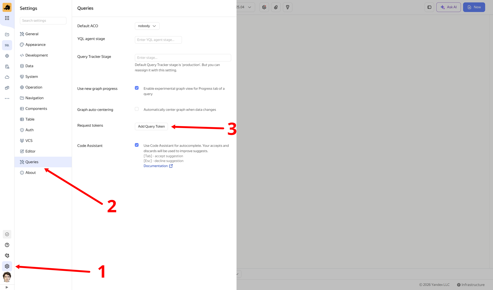
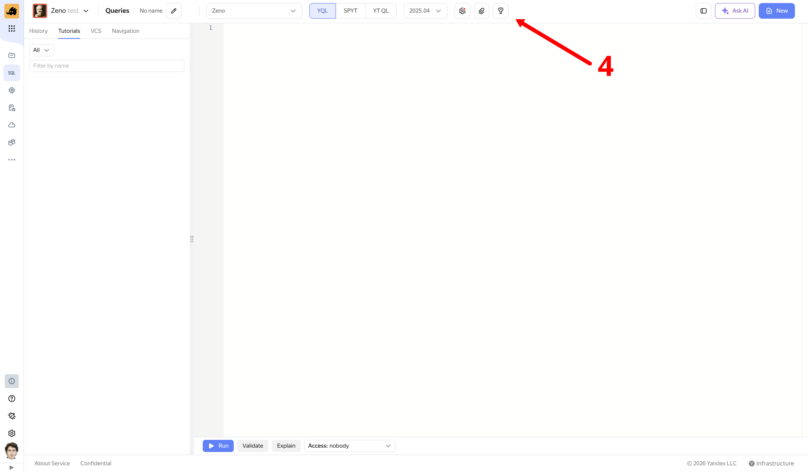

# Аутентификация в YQL over {{product-name}} Flow

Для аутентификации в {{product-name}} из-под отличного от задающего запрос пользователя, а также во внешних провайдерах (Monium, Logbroker) необходимо добавить токен через интерфейс {{product-name}}.

Перед тем, как добавить токен в настройках UI, нужно создать для него защищенную директорию в Кипарисе и загрузить в нее файл с токеном.

## Создание защищенной директории {#create-protected-directory}



Пользователь самостоятельно обеспечивает безопасность файла с токеном средствами ACL.<br>
Доступ к файлу с токеном должен быть только у вас — убедитесь, что никто другой не имеет прав на чтение этого узла.





Чтобы создать защищенную директорию, выполните следующие шаги:

1. Создайте новую директорию в Кипарисе:
  - нажмите на кнопку **Create object** в правой части интерфейса
  - в появившемся меню выберите **Directory**
2. Перейдите в нее
3. Зайдите на вкладку **ACL**
4. Запросите для себя явный доступ к директории:
  - нажмите на кнопку **Request permissions** в правом верхнем углу интерфейса
  - поставьте галочку напротив **Read/Write/Remove**
  - нажмите на кнопку **Me** напротив поля **Subjects**
  - нажмите кнопку **Confirm**
5. Дождитесь подтверждения заявки (если ответственный - вы, то это произойдет мгновенно)
6. Уберите наследование ACL от родительской директории:
  - нажмите на кнопку **Edit inheritance** в правом верхнем углу интерфейса
  - переведите переключалку **Inherit ACL** в выключенное положение
  - нажмите кнопку **Confirm**
7. Дождитесь подтверждения заявки








## Загрузка токена в защищенную директорию {#upload-token}

Пример команды:

```bash
cat /path/to/local/secret | {{yt-cli}} --proxy <кластер-пайплайна> write-file //path/to/secret/in/protected/directory
```

## Добавление токена в UI {#add-token}

Чтобы добавить токен, выполните следующие шаги:

1. Откройте **Settings** — нажмите на иконку шестерёнки в левом нижнем углу интерфейса.
2. В боковом меню настроек выберите вкладку **Queries**.
3. В разделе **Request tokens** нажмите кнопку **Add Query Token** и укажите путь к токену в Кипарисе.
4. Привяжите токен к запросу — нажмите кнопку с иконкой ключа в верхней панели инструментов (меню **Tokens**) и выберите нужные токены.

## Названия токенов {#token-names}

Чтобы токен использовался по умолчанию без указания дополнительных прагм, задайте ему соответствующее название:

- `default_ytflow` - для доступа к внутренним таблицам {{product-name}} Flow 
- `default_yt` - для доступа к {{product-name}}

- `default_solomon` — для доступа к Monium.
- `default_pq` - для доступа к Logbroker.


При необходимости выбора кастомного токена в данном запросе используйте соотв. прагму `{provider}.Auth`.












