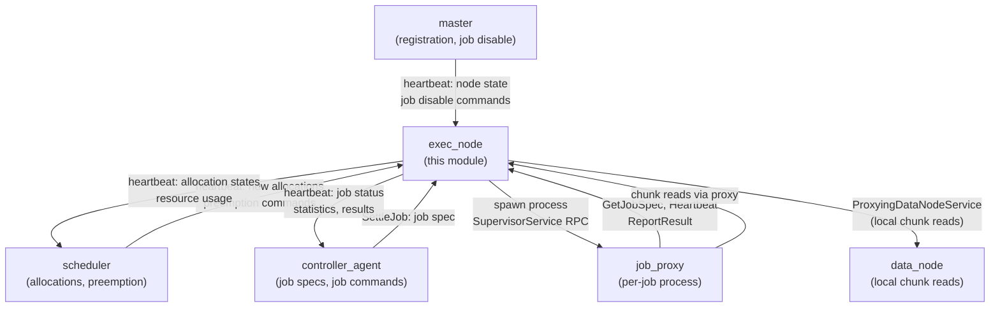
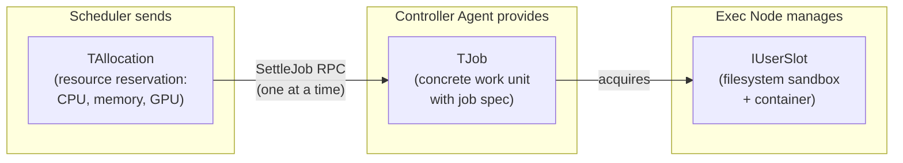
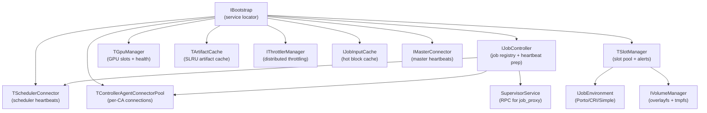
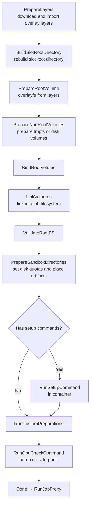
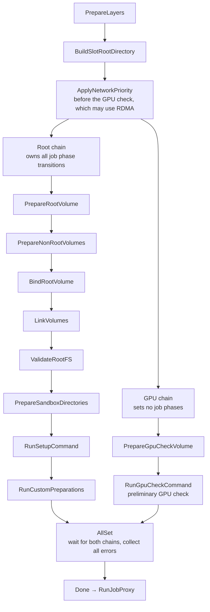

# Exec Node

## Purpose

Exec Node (`yt/yt/server/node/exec_node/`) is the **job execution subsystem** of the YT cluster node. It is responsible for receiving resource allocations from the scheduler, settling concrete jobs from controller_agent, preparing job workspaces (artifacts, container layers, volumes), spawning and supervising `job_proxy` processes, and reporting job results back to controller_agent.

Exec Node is implemented as a **"flavor"** of the unified cluster node process (alongside `data_node`, `tablet_node`, etc.) rather than a standalone binary. This allows a single node process to serve multiple roles simultaneously (e.g., both storing chunks and executing jobs), sharing infrastructure like master connection, RPC server, and resource management. The exec_node flavor is activated via bootstrap configuration.

## Position in the System



See also: [`../../job_proxy/ARCHITECTURE.md`](../../job_proxy/ARCHITECTURE.md) for what happens inside the job_proxy process.

## Key Abstractions

### Allocation → Job → Slot Model

The fundamental resource model has three levels:



- **`TAllocation`** — a resource reservation from the scheduler. Holds CPU/memory/GPU resources. Can sequentially host multiple jobs (one at a time) if the controller_agent sends a new job after the previous one finishes. Manages the allocation state machine: `Waiting → Running → Finished`.
- **`TJob`** — a single unit of work within an allocation. Owns the full job lifecycle: workspace preparation → job_proxy spawning → execution → result collection → cleanup. Has a two-dimensional state: `EJobState` (Waiting/Running/Aborting/Completed/Failed/Aborted) × `EJobPhase` (Created/PreparingNodeDirectory/DownloadingArtifacts/PreparingLayers/PreparingSlotDirectories/PreparingVolumes/RunningSetupCommands/SpawningJobProxy/Running/FinalizingJobProxy/Cleanup/Finished).
- **`IUserSlot`** — a numbered execution slot with a dedicated filesystem sandbox directory, user ID, and container. Acquired from `TSlotManager` when a job starts, released on cleanup.

### Component Map



### Core Classes

**[`IBootstrap`](bootstrap.h)** — central service locator for the exec_node flavor. Extends `NClusterNode::IBootstrapBase`. Provides typed accessors for all major subsystems. The single `CreateBootstrap(NClusterNode::IBootstrap*)` factory wires everything together.

**[`TAllocation`](allocation.h)** — resource owner (extends `NJobAgent::TResourceOwner`). Receives resource grants from `TJobResourceManager`, calls `SettleJob` on controller_agent to get a job spec, creates `TJob`, and manages the allocation state machine. Emits `AllocationPrepared`, `AllocationFinished`, `JobSettled`, `JobPrepared`, `JobFinished` signals.

**[`TJob`](job.h)** — the core job execution object. Orchestrates the entire job lifecycle: downloads artifacts, builds workspace via `TJobWorkspaceBuilder`, spawns job_proxy via `IUserSlot::RunJobProxy`, supervises via `SupervisorService`, collects results, and cleans up. Holds `TJobFSSecretary` for filesystem description, `IJobProbePtr` for probing the running job_proxy.

**[`TJobFSSecretary`](job_fs_secretary.h)** — stores and manages the job's filesystem description: artifact list, layer keys, Docker image, root/GPU-check/tmpfs volumes, NBD device IDs. Shared between `TAllocation` (across sequential jobs) and `TJob` (for the current job). Separates "what the filesystem should look like" from "how to build it".

**[`IJobController`](job_controller.h)** — central job registry. Maintains a map of all active jobs. Prepares scheduler heartbeat requests (allocation states) and processes responses (new allocations, preemption). Prepares controller_agent heartbeat requests (job status/statistics) and processes responses (job commands). Exposes `FindJob`, `GetJobOrThrow`, `FindRecentlyRemovedJob`.

**[`TSlotManager`](slot_manager.h)** — manages the pool of `IUserSlot` instances. Handles slot acquisition (`AcquireSlot`) and release. Tracks `ESlotManagerAlertType` alerts (Porto failures, GPU check failures, too many consecutive aborts/GPU failures, job_proxy unavailability). Supports resurrection: can re-initialize after fixable alerts. Manages NUMA node affinity for CPU scheduling.

**[`IUserSlot`](slot.h)** — per-job execution slot. Key methods: `RunJobProxy` (spawns the job_proxy process), `PrepareSandboxDirectories` (sets up quotas), `PrepareRootVolume`/`PrepareTmpfsVolumes`/`LinkTmpfsVolumes` (volume management), `MakeLink`/`MakeCopy`/`MakeFile` (artifact placement), `RunPreparationCommands` (setup commands), `CleanProcesses`/`CleanSandbox` (cleanup).

**[`IJobEnvironment`](job_environment.h)** — node-level container backend. Initializes all slots (`Init`, `InitSlot`), runs job_proxy processes (`RunJobProxy`), cleans processes (`CleanProcesses`), manages CPU limits, creates `IJobDirectoryManager` and `IVolumeManager`. Implementations: Porto, CRI, Simple.

**[`TJobWorkspaceBuilder`](job_workspace_builder.h)** — orchestrates the workspace preparation pipeline as a sequence of async steps. Emits `UpdateBuilderPhase` signals to update `TJob`'s phase. Implementations: `SimpleJobWorkspaceBuilder`, `PortoJobWorkspaceBuilder`, `CriJobWorkspaceBuilder`.

**[`TSchedulerConnector`](scheduler_connector.h)** — periodic heartbeats to the scheduler. Prepares requests with allocation states and resource usage; processes responses with new allocations and preemption commands. Triggers out-of-band heartbeats when resources are acquired/released or allocations finish.

**[`TControllerAgentConnectorPool`](controller_agent_connector.h)** — manages one `TControllerAgentConnector` per known controller_agent instance. Each connector: settles jobs (`SettleJob` RPC), sends periodic heartbeats with job status/statistics, processes responses with job commands (abort, interrupt, store). Handles agent incarnation changes.

**[`TArtifactCache`](artifact_cache.h)** — SLRU cache for downloaded artifacts (user files, binaries, container layers). Deduplicates concurrent downloads of the same artifact. Backed by `TCacheLocation` disk locations.

**[`TGpuManager`](gpu_manager.h)** — discovers GPU devices (via `/dev` enumeration or `GpuInfoProvider` depending on config), manages GPU slot acquisition/release, runs periodic health checks, fetches driver layers from Cypress (Nvidia only), tracks RDMA devices. Supports multiple GPU flavors via `EGpuFlavor`. Emits alerts on GPU failures.

**[`IThrottlerManager`](throttler_manager.h)** — distributed bandwidth throttler. Uses the discovery service to coordinate limits across all exec_nodes in the cluster. Tracks per-cluster incoming traffic utilization. job_proxy throttlers call back into exec_node via RPC (see [`../../job_proxy/ARCHITECTURE.md`](../../job_proxy/ARCHITECTURE.md)).

**[`IJobInputCache`](job_input_cache.h)** — caches hot chunk blocks in memory across jobs. Reduces repeated network reads when multiple jobs read the same input chunks. Registered chunks are tracked per-job and unregistered on job completion.

## Job Lifecycle

```mermaid
stateDiagram-v2
    [*] --> AllocationWaiting: Scheduler heartbeat\n(new allocation)
    AllocationWaiting --> ResourcesAcquired: TJobResourceManager\ngrants resources
    ResourcesAcquired --> JobSettling: SettleJob RPC\nto controller_agent
    JobSettling --> WorkspacePreparing: Job spec received\n(TJob created)
    WorkspacePreparing --> JobProxySpawning: Workspace ready\n(artifacts + volumes)
    JobProxySpawning --> JobRunning: job_proxy spawned\nOnJobProxySpawned()
    JobRunning --> ResultReceived: job_proxy reports result\nvia SupervisorService
    ResultReceived --> Cleanup: TJob::Cleanup()
    Cleanup --> NextJobOrFinish: Slot released

    NextJobOrFinish --> JobSettling: New job settled\n(same allocation)
    NextJobOrFinish --> AllocationFinished: No new job\nor allocation aborted

    JobRunning --> Aborting: Abort/Interrupt\ncommand from CA
    Aborting --> Cleanup: job_proxy exits

    WorkspacePreparing --> Cleanup: Preparation failed
    AllocationFinished --> [*]
```

**Inside job_proxy** (after spawning): see [`../../job_proxy/ARCHITECTURE.md`](../../job_proxy/ARCHITECTURE.md). The job_proxy calls `GetJobSpec` on `SupervisorService`, runs the job, sends periodic heartbeats, and calls `ReportResult` when done.

## Workspace Preparation Pipeline

`TJob` prepares the node directory and downloads artifacts, then `TJobWorkspaceBuilder::Run()` builds the job workspace. For the simple and CRI builders every step runs sequentially:



`TPortoJobWorkspaceBuilder::Run()` overrides this: after layer preparation, slot root directory rebuilding and network priority application it forks the remaining steps into two chains that run in parallel.



- Network priority is applied before both chains so that the GPU check (which may use RDMA) runs with the correct network settings.
- Only the root chain drives job phases; the GPU chain performs no phase transitions, so the reported phase timeline stays monotonic.
- The chains are joined with `AllSet`, so both always run to completion: every volume they create reaches `TJobFSSecretary` for cleanup. All errors from both chains are reported (a failure in the shared prefix is reported once).

During `PreparingLayers`, overlay layers for root, GPU check and non-root volumes are downloaded and imported in parallel; the resulting `TOverlayData` is stored in `TJobFSSecretary::PreparedLayers_` and consumed by subsequent volume-preparation steps. `TJobFSSecretary` is owned by `TAllocation`, so `PreparedLayers_` lives for the whole allocation: subsequent jobs in the same allocation skip the layer-import step for keys that are already present (only new keys go through `slot->PrepareLayers`). The strong `TLayerPtr` references stored inside each `TOverlayData` keep the underlying `TLayer` alive even if the SLRU `TLayerCache` decides to evict the entry, which both prevents redundant re-imports and keeps the on-disk layer files until the allocation finishes.

During `PreparingSlotDirectories`, `DoBuildSlotRootDirectory` calls `IUserSlot::BuildSlotRootDirectory` after layer preparation and before volume preparation. This step wipes and recreates `Home`, `Tmp`, `Cores`, `Pipes` and `User`, but only creates missing `Logs` and porto place directories, preserving reusable root volumes for the allocation's lifetime. Location initialization, job cleanup (`CleanSandboxes`) and allocation cleanup (`CleanPortoPlace`) do not rebuild the layout; missing slot directories are created during job preparation.

Artifacts are placed into the sandbox via `IUserSlot`: symlinks (`MakeLink`), copies (`MakeCopy`), or bind-mounts (`MakeFileForSandboxBind`). The `TJobFSSecretary` tracks which artifacts go where and whether they can be accessed via virtual sandbox (NBD-backed) or direct bind.

## Scheduler Communication

`TSchedulerConnector` runs a `TRetryingPeriodicExecutor` that sends heartbeats to the scheduler's `AllocationTrackerService`:

- **Request** (prepared by `IJobController::PrepareSchedulerHeartbeatRequest`): current allocation states, resource usage, finished allocations, min spare resources hint.
- **Response** (processed by `IJobController::ProcessSchedulerHeartbeatResponse`): new allocations to start, allocations to abort/preempt, registered controller_agent descriptors.

Out-of-band heartbeats are triggered immediately when: resources are acquired/released, an allocation finishes, or the scheduler explicitly requests one.

**Preemption**: the scheduler sends a preemption command with a timeout and reason. `TAllocation::Preempt()` calls `TJob::Interrupt()` which forwards to job_proxy via `IJobProbe::Interrupt()`. If the job doesn't finish within the timeout, it is forcefully aborted.

## Controller Agent Communication

`TControllerAgentConnectorPool` maintains one `TControllerAgentConnector` per known controller_agent instance (identified by `TControllerAgentDescriptor`). The pool is updated when the scheduler heartbeat response includes a new set of registered agents.

Each `TControllerAgentConnector`:
- **`SettleJob`** RPC: called by `TAllocation` to get a job spec for a given allocation. Returns `TJobStartInfo` with `JobId` and `TJobSpec` proto.
- **Heartbeat** (periodic): sends job status, statistics, stderr size, and finished job results. Receives job commands: abort, interrupt, store (mark job result as stored in archive), update controller_agent descriptor.
- **Out-of-band heartbeat**: triggered when a job finishes to minimize result reporting latency.
- **Incarnation tracking**: if the agent's incarnation ID changes (agent restart), all jobs affiliated with the old incarnation are aborted via `OnAgentIncarnationOutdated`.

## Slot & Environment Management

**`TSlotManager`** maintains a ring queue of free slot indices. Slot acquisition (`AcquireSlot`) pops an index; release pushes it back. Two slot types:
- `ESlotType::Common` — normal CPU policy
- `ESlotType::Idle` — idle CPU policy (for low-priority jobs)

NUMA node affinity is optionally enforced: slots can be pinned to specific NUMA nodes to reduce cross-NUMA memory access.

**Alert system**: `TSlotManager` tracks `ESlotManagerAlertType` alerts:
- `PortoFailure`, `JobEnvironmentFailure` — fixable by resurrection (re-init)
- `GpuCheckFailed`, `TooManyConsecutiveGpuJobFailures`, `TooManyConsecutiveJobAbortions` — fixable by RPC request
- `JobProxyUnavailable` — transient, clears when job_proxy binary becomes available

When armed persistent alerts exist, `IsJobSchedulingDisabled()` returns true and the scheduler stops sending new allocations.

**`IJobEnvironment`** implementations:
- **Porto** — full container isolation; supports rootfs layers, GPU, network namespaces, PID namespaces, disk quotas. Primary production backend.
- **CRI** — container runtime interface (e.g., containerd); similar capabilities via different API.
- **Simple** — cgroup-based, no full container support; used where Porto/CRI is unavailable.

## Artifact & Volume Management

**`TArtifactCache`** is an SLRU cache backed by `TCacheLocation` disk locations. `DownloadArtifact` deduplicates concurrent downloads of the same `TArtifactKey`. Artifacts include: user files, executable binaries, and container layers (Porto layers, Docker images).

**`IVolumeManager`** manages:
- **Root volumes** (`PrepareVolume`): overlayfs stacks of layers. Porto implementation uses Porto volumes; Simple implementation uses bind mounts.
- **Tmpfs volumes** (`PrepareTmpfsVolumes`): in-memory filesystems for job scratch space.
- **Rbind volumes** (`RbindRootVolume`): bind-mount of an existing volume (legacy compat).

**`TTmpfsLayerCache`**: keeps frequently-used layers in a tmpfs mount for fast access, avoiding repeated disk reads.

**`IJobDirectoryManager`**: manages sandbox directories with disk quotas (Porto: via Porto disk limits; Simple: via project quotas or no quota).

## GPU Management

`TGpuManager` supports multiple GPU flavors via `EGpuFlavor` (Nvidia, Other). The flavor is set in `TGpuManagerConfig::GpuFlavor` and affects device discovery, driver layer handling, and container configuration.

**Device discovery** has two modes controlled by `UseGpuInfoProviderForDeviceDiscovery`:
- **Disabled** (default, Nvidia-only): enumerates `/dev/nvidia*` devices via `ListNvidiaGpuDevices()` at startup. Unknown devices found during health checks are logged but ignored.
- **Enabled** (required for non-Nvidia): queries `GpuInfoProvider` for device list. New devices discovered during health checks are dynamically added to the GPU slot pool.

Non-Nvidia flavors require `UseGpuInfoProviderForDeviceDiscovery` and do not support Porto job environment. Nvidia-specific behavior (driver version detection, driver layer fetching, Nvidia container env vars) is skipped for non-Nvidia flavors.

`TGpuManager` runs several periodic executors:
- **Health check**: polls GPU info provider, updates `HealthyGpuInfoMap_`, detects lost devices, discovers new devices (when enabled), populates alerts.
- **Driver layer fetch** (Nvidia only): periodically checks Cypress for updated GPU driver layers and updates `DriverLayerKey_`.
- **RDMA device info update**: tracks RDMA device statistics for network-intensive GPU workloads.

`TGpuSlot` stores the device name directly (obtained from `TGpuInfo` at acquisition time) rather than deriving it from the device index, enabling support for non-Nvidia device naming schemes.

GPU slot acquisition (`AcquireGpuSlots`) returns `TGpuSlot` objects that release back to the free pool on destruction.

`TJobGpuChecker` runs GPU check commands (preliminary before job, extra after job) in a container to verify GPU health. Failures trigger `TSlotManager` alerts.

## Throttling & Input Caching

**`IThrottlerManager`** creates and manages `IThroughputThrottler` instances for `EExecNodeThrottlerKind` × `EThrottlerTrafficType` × `TClusterName`. Uses the YT discovery service to form a group of exec_nodes and elect a leader that aggregates utilization metrics. job_proxy throttlers call back into exec_node via `SupervisorService` RPC to coordinate node-wide bandwidth limits (see [`../../job_proxy/ARCHITECTURE.md`](../../job_proxy/ARCHITECTURE.md), Throttling section).

**`IJobInputCache`** caches chunk blocks in memory across jobs. When a job registers its input chunks (`RegisterJobChunks`), the cache pre-fetches and retains hot blocks. `ProxyingDataNodeService` uses this cache to serve job_proxy chunk read requests from memory instead of disk/network.

## Supervisor Service

`SupervisorService` is the RPC service that job_proxy calls into exec_node. It is the primary communication channel between exec_node and job_proxy (see [`../../job_proxy/ARCHITECTURE.md`](../../job_proxy/ARCHITECTURE.md), Heartbeat & Lifecycle section).

Key RPC methods:
| Method | Direction | Purpose |
|---|---|---|
| `GetJobSpec` | job_proxy → exec_node | Retrieve `TJobSpec` proto for this job |
| `OnJobProxySpawned` | job_proxy → exec_node | Signal that job_proxy process is ready |
| `OnArtifactsPrepared` | job_proxy → exec_node | Signal that artifacts are prepared (gates job start) |
| `OnJobPrepared` | job_proxy → exec_node | Signal that job is fully prepared and running |
| `Heartbeat` | job_proxy → exec_node | Report memory usage; receive approved memory reserve |
| `UpdateResourceUsage` | job_proxy → exec_node | Update CPU/network resource usage |
| `ThrottleJob` | job_proxy → exec_node | Request bandwidth throttle token |
| `OnJobFinished` / `ReportResult` | job_proxy → exec_node | Deliver `TJobResult` proto |

## Dependencies

- **Depends on:**
  - `yt/yt/server/node/cluster_node/` — base bootstrap, master connection, resource manager, node resource tracking
  - `yt/yt/server/node/data_node/` — `TArtifactCache` uses data_node chunk infrastructure; `ProxyingDataNodeService` proxies to data_node
  - `yt/yt/server/node/job_agent/` — `TJobResourceManager`, `TResourceHolder` for resource accounting
  - `yt/yt/server/lib/exec_node/` — `TSupervisorServiceProxy`, configs, shared types
  - `yt/yt/server/lib/job_proxy/` — `TJobProxyInternalConfig`, `EJobEnvironmentType`
  - `yt/yt/server/lib/scheduler/` — allocation structs, scheduler protocol types
  - `yt/yt/library/containers/` — Porto container management
  - `yt/yt/ytlib/chunk_client/` — chunk reading for artifact download
  - `yt/yt/ytlib/controller_agent/proto/` — `TJobSpec`, `TJobResult` protobuf definitions

- **Depended upon by:**
  - `yt/yt/server/job_proxy/` — spawned as a child process; communicates via `SupervisorService` RPC
  - `yt/yt/server/node/cluster_node/` — exec_node bootstrap is created by cluster_node bootstrap

## Invariants & Constraints

1. **One job per allocation at a time**: `TAllocation` holds at most one `TJob`. A new job can only be settled after the previous one has finished and been cleaned up.
2. **Thread affinity**: All job and allocation state mutations run on `JobThread`. Do not mutate job/allocation state from other threads without going through the job invoker.
3. **Slot count is fixed at startup**: `TSlotManager::SlotCount_` is set from config and does not change at runtime. Slot resurrection re-initializes existing slots, it does not add new ones.
4. **Alert-based disabling is sticky**: Once a persistent alert is set, job scheduling stays disabled until the alert is explicitly reset (via RPC or restart). Do not silently swallow errors that should set alerts.
5. **Cleanup must complete**: `TJob::Cleanup()` must always run, even on abnormal termination. It releases the slot, GPU slots, and resources. Failure to clean up leaks slots permanently.
6. **Supervisor channel loss is fatal for job_proxy**: If job_proxy cannot reach `SupervisorService`, it exits. exec_node detects this via `OnJobProxyFinished` callback and transitions the job to failed state.
7. **`TJobFSSecretary` is shared across sequential jobs**: It is owned by `TAllocation`, not `TJob`. When a new job starts in the same allocation, `OnNewJobStarted` is called to reset per-job state while preserving allocation-level state.

## Anti-patterns (Do NOT)

- **Do NOT** call `TJob` or `TAllocation` methods from threads other than `JobThread` without using the job's invoker.
- **Do NOT** hold strong references to `TJob` in long-lived objects — use weak pointers to avoid preventing cleanup.
- **Do NOT** add new alert types without explicitly classifying them as fixable-by-resurrect, fixable-by-request, persistent, or transient in `TSlotManager::TAlertSet`.
- **Do NOT** bypass `TArtifactCache` for artifact downloads — direct downloads skip deduplication and quota tracking.
- **Do NOT** add environment-specific logic directly to `TJob` — extend `IJobEnvironment` or `TJobWorkspaceBuilder` instead.
- **Do NOT** call `IUserSlot` methods after `CleanProcesses()` — the container may no longer exist.
- **Do NOT** forget to release allocation-scoped `TJobFSSecretary` resources on allocation cleanup — reusable volumes, prepared layers, and artifact cache entries are all kept across sequential jobs in the same allocation.
- **Do NOT** call `TJobFSSecretary::ReleaseVolumes()`, `ReleasePreparedLayers()`, or `ReleaseArtifacts()` from `OnNewJobStarted` or `TJob::Cleanup`. Reusable volumes and prepared layers must live for the lifetime of the allocation; they are released once in `TAllocation::OnAllocationFinished`.

## Extension Points

**Adding a new job environment backend:**
1. Implement `IJobEnvironment` in a new `*_job_environment.h/cpp` file.
2. Add a new `EJobEnvironmentType` value in `yt/yt/server/lib/job_proxy/public.h`.
3. Add the corresponding config struct inheriting `TJobEnvironmentConfigBase`.
4. Register in `CreateJobEnvironment()` factory in [`job_environment.cpp`](job_environment.cpp).
5. Implement a corresponding `TJobWorkspaceBuilder` subclass if workspace preparation differs.
6. Implement a corresponding `IVolumeManager` if volume management differs.

**Adding a new volume type:**
1. Add a new `EVolumeType` value in [`public.h`](public.h).
2. Implement `IVolume` in a new file.
3. Add preparation logic to `IVolumeManager` implementations.
4. Add the new volume type to `TJobWorkspaceBuilder` pipeline steps.

**Adding new throttler kinds:**
1. Add a new `EExecNodeThrottlerKind` value in `yt/yt/server/lib/exec_node/public.h`.
2. Register the throttler in `IThrottlerManager::GetOrCreateThrottler()`.
3. Expose it via `IBootstrap::GetThrottler()`.
4. Add the corresponding RPC method to `SupervisorService` if job_proxy needs to use it.
